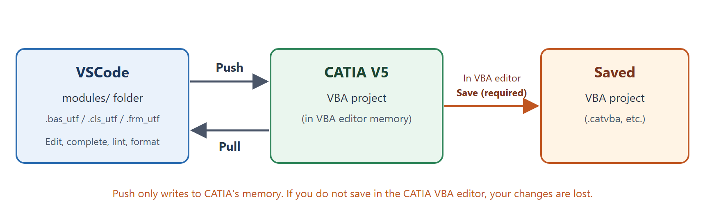
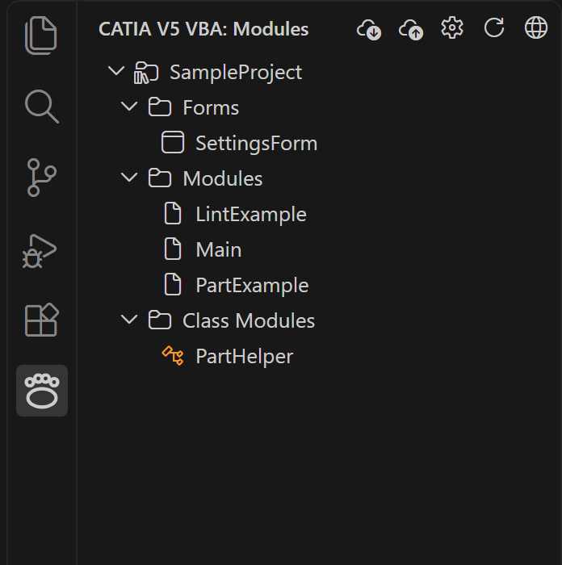

# Cat5Dev

English | [日本語](docs/ja/README.ja.md) | [简体中文](docs/zh-CN/README.zh-CN.md)

Cat5Dev is a VSCode extension for developing CATIA V5 VBA macros in VSCode.
It transfers modules between a CATIA VBA project and VSCode, so you can edit them in VSCode with completion, lint, and formatting.

---

## Features

| Feature | Summary | Details |
|---------|---------|---------|
| **Pull / Push** | Sync modules between the CATIA VBA project and the `modules/` folder. Only changed modules are sent, and you are asked before anything is deleted | [Sync](docs/en/sync.md) |
| **Module tree** | Shows modules by type in a side panel. Rename, delete, and copy path | [Sync](docs/en/sync.md#module-tree) |
| **IntelliSense** | Code completion including the CATIA API, hover, Go to Definition, parameter hints, and detection of nonexistent members | [IntelliSense](docs/en/intellisense.md) |
| **Symbol navigation** | Outline, breadcrumbs, and `Ctrl+Shift+O` to jump to a procedure | [IntelliSense](docs/en/intellisense.md#symbol-navigation) |
| **VBA Lint** | 10 rules, such as missing `Option Explicit`, unused variables, missing `End If`, and characters that CATIA VBA cannot represent (disabled by default) | [Lint and Formatter](docs/en/lint-format.md#vba-lint) |
| **VBA Formatter** | Keyword capitalization, indentation, and whitespace / blank line cleanup (disabled by default) | [Lint and Formatter](docs/en/lint-format.md#vba-formatter) |
| **Multilingual UI** | 日本語, English, 简体中文 | [Configuration](docs/en/configuration.md#display-language) |

---

## Requirements

- Windows (64-bit)
- CATIA V5 running, with the VBA project you want to sync open
- **The CATIA VBA editor (`Alt+F11`) opened at least once before you Pull / Push** (you may close it afterwards)
- VSCode 1.85 or later

Cat5Dev communicates with CATIA over COM through its bundled helper `catia-run.exe`, which runs on .NET Framework 4.x (preinstalled on Windows 10/11).

For project selection and Pull / Push, Cat5Dev temporarily loads a helper VBA project, `C5D_Bridge`, into CATIA and removes it when the operation ends. You may briefly see `C5D_Bridge` in the VBA editor while an operation is running; it is never saved. VBScript is not used ([how it works](docs/en/sync.md#how-cat5dev-talks-to-catia)).
The `C5D_Bridge` file is kept in `%LOCALAPPDATA%\Cat5Dev\bridge\`, and a link to it (using almost no disk space) is added there at each operation. CATIA keeps these links in use while it is running; they are deleted automatically at the next operation after CATIA exits ([files in the `bridge` folder](docs/en/sync.md#files-in-the-bridge-folder)).

---

## Installation

Cat5Dev is distributed as a `.vsix` file.

1. **Download the `.vsix` file**\
   Get `cat5dev-x.x.x.vsix` from the [Releases page](https://github.com/kantoku-code/Cat5Dev/releases).

2. **Install it in VSCode**\
   Open the Extensions view (`Ctrl+Shift+X`), and choose **Install from VSIX...** from the `⋯` menu at the top right.

   

3. **Select the file**\
   Select the downloaded `.vsix` file to install it.

> [!WARNING]
> **Before using Cat5Dev for the first time, back up your CATIA V5 settings folder.**\
> In rare cases, CATIA settings can become corrupted. With a backup, you can restore them.
>
> 1. Press `Win+R` and enter `%APPDATA%`
> 2. Open the `Dassault Systemes\CATSettings` folder
> 3. Copy the folder and paste it somewhere safe (Desktop, OneDrive, etc.)
> 4. Rename it (e.g. `CATSettings_backup_2026-04-18`)

---

## Getting Started

1. Open a working folder in VSCode.
2. Run **`CATIA: Initialize Project (cat5dev.toml)`** from the Command Palette (`Ctrl+Shift+P`).\
   This creates the settings file `cat5dev.toml` and a `.gitignore`.
3. Start CATIA V5 and open the VBA project you want to sync.\
   **Also open the VBA editor (`Alt+F11`) once.** Pull / Push does not work until the VBA editor has been opened (you may close it afterwards).
4. Click the **CATIA V5 VBA** icon in the Activity Bar to open the panel.
5. Click the ⚙️ button and select the target VBA project.
6. Click the ☁️↓ button (Pull) to import the modules into the `modules/` folder.
7. Edit the code in VSCode.
8. Click the ☁️↑ button (Push) to send your changes to CATIA.
9. **Save the project in the CATIA VBA editor** (see the note below).

> [!TIP]
> Lint and the formatter are disabled by default. To use them, set `enabled = true` in the `[lint]` and `[formatter]` sections of `cat5dev.toml` (see [Lint and Formatter](docs/en/lint-format.md)).

---

## Important: Save in the CATIA VBA Editor After Pushing

Push only writes to the VBA project in CATIA's memory. **If you close CATIA without saving, all pushed changes are lost.**\
After pushing from VSCode, save in the CATIA VBA editor (`Ctrl+S`).

Push may also ask **whether to delete modules from CATIA that do not exist in VSCode**. Check the list carefully before you choose (see [Sync](docs/en/sync.md#push-vscode--catia)).

---

## Characters That CATIA VBA Cannot Represent (VBA010)

CATIA VBA stores code in the Windows ANSI code page, so characters that this code page cannot represent (emoji, etc.) are replaced with `?` or another character when you Push. The lint rule VBA010 `non_ansi_character` warns you about such characters before you Push (when Lint is enabled).

- The code page used for the check is `ansi_code_page` in `[lint.rules]` of `cat5dev.toml`. The `cat5dev.toml` created by `CATIA: Initialize Project (cat5dev.toml)` contains the value for the display language: Japanese = 932 / English = 1252 (Windows-1252) / Chinese = 936. `0` detects the system ANSI code page automatically.
- When you switch the display language with the 🌐 button (`CATIA: Switch Language`), `ansi_code_page` is rewritten together with `language` to the value for the new language (a value you wrote by hand, or `0`, is overwritten too). Lint runs again right away with the new value.
- The English value 1252 has not yet been confirmed on an English CATIA installation.
- `ansi_code_page` is used only for the lint check and does not change how Push / Pull work. It is different from `encoding` in `[project]`, which was removed in 0.7.0.

For details, see [VBA010](docs/en/lint-format.md#vba010-characters-that-catia-vba-cannot-represent) and [Display language](docs/en/configuration.md#display-language).

---

## Documentation

| Page | Contents |
|------|----------|
| [Syncing with CATIA](docs/en/sync.md) | How Pull / Push work and their confirmation dialogs, the module tree, how Cat5Dev talks to CATIA (the C5D_Bridge helper project and the `bridge` folder), the sync lock and recovery, character encoding |
| [IntelliSense](docs/en/intellisense.md) | Completion, hover, Go to Definition, parameter hints, the `'@As` type hint, CATIA API type information |
| [Lint and Formatter](docs/en/lint-format.md) | Lint rules, formatter operations and options |
| [Configuration Reference](docs/en/configuration.md) | All `cat5dev.toml` settings, display language, VSCode settings, files that are created |
| [Troubleshooting](docs/en/troubleshooting.md) | Common problems and fixes, reading the Output panel |

---

## Limitations

- You cannot debug in VSCode. Use the CATIA VBA editor for debugging.
- Only the code of UserForms is handled. Edit the form design (control layout) in the CATIA VBA editor.
- Push cannot create new UserForms. Create an empty form with the same name in CATIA first.

---

## Why VBA?

I have tried developing CATIA V5 macros in several languages, but I came back to VBA for a few reasons:

- **Native support** — VBA is built directly into CATIA V5
- **Best development environment** — The VBE is still the most complete and stable option
- **Surprisingly fast** — In many cases VBA outperformed the alternatives
- **Compact distribution** — No external runtime or dependencies required

Do I like VBA as a language?\
That is another story.

---

## License

MIT
