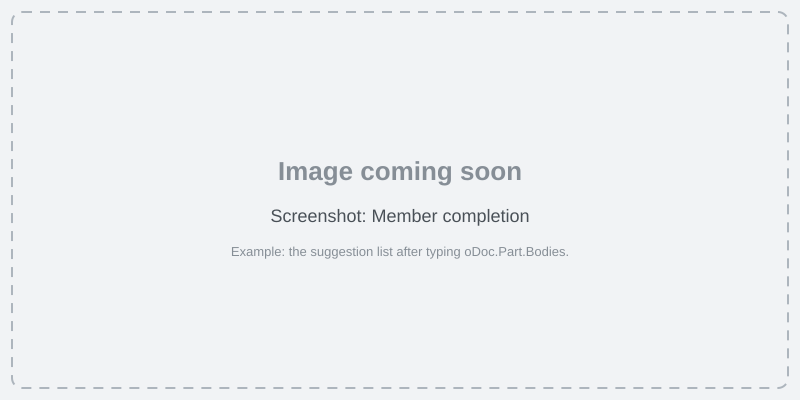
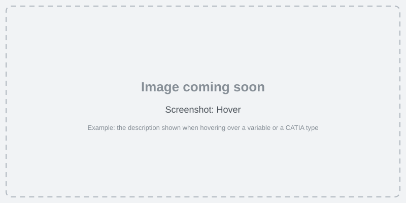

# IntelliSense (Completion, Hover, Go to Definition)

[← Back to README](../../README.md)

Cat5Dev includes a language server for VBA (`vba-ls`). The following features are available while you edit `.bas_utf` / `.cls_utf` / `.frm_utf` files. No configuration is needed.

| Feature | How to use |
|---------|------------|
| [Code completion](#code-completion) | Appears automatically as you type, or press `Ctrl+Space` |
| [Hover](#hover) | Move the mouse over an identifier |
| [Go to Definition](#go-to-definition) | `F12` or `Ctrl+Click` |
| [Parameter hints](#parameter-hints) | Appear automatically when you type `(`, `,` or a space |
| [Type coloring](#type-coloring) | Automatic |
| [Nonexistent member detection](#nonexistent-member-detection) | Automatic (squiggles and the Problems panel) |
| [Symbol navigation](#symbol-navigation) | Outline, breadcrumbs, `Ctrl+Shift+O` |

Type information for CATIA V5 objects (`Part`, `PartDocument`, `HybridShapeFactory`, etc.) is built in, so CATIA methods and properties are completed too.

---

## Code completion



| Where you type | Suggestions | Example |
|----------------|-------------|---------|
| After `.` | Methods and properties of that type | `CATIA.ActiveDocument.` → members of `Document` |
| After `As ` / `New ` / `Implements ` | Type names | `Dim oPart As ` → `Part`, `Body`, … |
| After `Exit ` / `End ` / `On Error ` / `Option `, etc. | The keywords that can follow | `End ` → `If`, `Sub`, `With`, … |
| Anywhere else | Variables, procedures, constants, keywords | `oP` → `oPart`, … |

- **Completion after `.`** also works for `.Foo` inside a `With` block, `Me.`, array elements and `Item` results, function return values, and module names (`Module1.`).
- **Type completion** lists your own classes, user-defined types, and enums first, then VBA types, then CATIA types. After `New `, only creatable types (classes, `Collection`, `Dictionary`, etc.) appear. You can also narrow by library name, as in `As MECMOD.`.
- **Identifier completion** is ordered: local variables → variables and procedures in the module → Public items in other modules → VBA functions and constants, CATIA enum values → keywords.
- No completion is offered inside strings or comments.

---

## Hover



Move the mouse over an identifier to see its declaration and description.

- **Variables and procedures** — The declaration (e.g. `Dim oPart As Part`, `Function GetName(ByVal n As Long) As String`) and its documentation comment
- **Members** — The signature of `Foo` in `x.Foo` (e.g. `Add(Name As String) As Body`)
- **CATIA types** — The type name, its library, and its inheritance chain (e.g. `PartDocument ← Document ← …`)
- **VBA functions and constants** — The signature and description

### Documentation comments
Comments written on the **lines directly above** a declaration are shown as its description in hover and completion. For variables, a comment at the end of the line also works.

```vba
' Returns the name of the part
' n: part number
Function GetName(ByVal n As Long) As String
    Dim oPart As Part   ' the part being edited
    ...
End Function
```

If a blank line or code comes in between, the comment is not used as a description.

---

## Go to Definition

Press `F12` (or `Ctrl+Click`) to jump to where a variable, procedure, class, or module is defined. This also works for items defined in other modules.

- For a module name or class name, it jumps to the top of that file.
- Items built into CATIA or VBA have no definition location, so nothing happens.

---

## Parameter hints

When you type `(` or `,` in a function call, the parameter list appears with the current parameter highlighted.

- Calls without parentheses (`MsgBox "x", `, `Err.Raise `, etc.) are also supported.
- Named arguments (`Title:=`) are also supported.
- If a parameter's type is a CATIA enum, up to 10 allowed values are shown.

---

## Type coloring

Variables whose type is an object (a CATIA type, `Collection`, your own class, etc.) and type names after `As` are shown in a different color from ordinary variables. Variables of basic types such as `Long` and `String` are not affected.

---

## Nonexistent member detection

If you write a method or property after `.` that does not exist on that type, it is marked with a squiggle. The source shown in the Problems panel is `vba-ls`.

| Type | Severity | Example message |
|------|----------|-----------------|
| VBA types, your own classes and modules | Error | `'clsFoo' に 'Bar' は存在しません` ('Bar' does not exist on 'clsFoo') |
| CATIA types | Warning | `'PartDocument' に 'Bogus' は存在しません（派生型を含む）` ('Bogus' does not exist on 'PartDocument', including derived types) |

- These messages are always shown in Japanese.
- For CATIA types, no warning is given if the member exists on a **derived type** of the declared type (e.g. `d.Part` is OK with `Dim d As Document`).
- Modules with syntax errors and UserForms (no control information is available) are not checked.
- This detection is separate from the `[lint]` settings in `cat5dev.toml`, and there is no setting to disable it.

---

## Type hints `'@As`

Variables declared `As Object` or `As Variant` have an unknown type, so no completion appears. For example, `Set oDoc = CATIA.ActiveDocument` does not make the type inferable.

For such variables, you can specify the type in an **end-of-line comment** on the declaration.

```vba
Sub Main()
    Dim oDoc As Object '@As PartDocument
    Set oDoc = CATIA.ActiveDocument
    oDoc.Part.Bodies.          ' ← members of Bodies are completed

    Dim sel '@As Selection                 ' also works for variables with no declared type
    Dim oBody As Object 'As MECMOD.Body    ' @ is optional; a library prefix is allowed
End Sub
```

- The format is `'@As TypeName` or `'As TypeName` (case-insensitive). The whole comment must have this form (anything after it, as in `'As Part description`, makes it ignored).
- Works with `Dim` / `Static` / module-level `Public` / `Private`. A type hint on a Public variable also applies when the variable is used from other modules.
- It works only when one variable is declared per line (`Dim a As Object, b As Object '@As Part` is ignored).
- It cannot be used on variables with an explicit type such as `As Long`, or on procedure parameters.
- The actual declaration does not change. The hint is used only for completion, hover, parameter hints, detection, and Go to Definition.
- If the type name is not found, the hint is ignored.

> [!TIP]
> Variables with no declared type that are assigned like `Set x = New Foo` or `Set x = CreateObject("Scripting.Dictionary")` get their type inferred even without a type hint.

---

## CATIA API type information

CATIA V5 type information is loaded from the bundled database `bin/catia_api.db` (built from 102 CATIA V5 type libraries; it **does not include descriptions** of methods and properties).

### Showing API descriptions
You can build a database with descriptions from the help file (`V5Automation.chm`) that comes with your CATIA installation.

1. Build the database by following [tools/tlb-extractor/README.md](../../tools/tlb-extractor/README.md)
2. Set the environment variable `CAT5DEV_TLB_DB` to the full path of the database you built
3. Restart VSCode

> [!NOTE]
> The descriptions are copyrighted by Dassault Systèmes. Do not share the database you build or commit it to a repository.

---

## Cross-module features

Files directly under the `modules/` folder of the workspace are loaded, so completion, hover, and Go to Definition work across modules (if there is no `modules/`, files directly under the workspace root are used).

- **Standard modules** — Public procedures and variables can be used as is (`Foo`) or with the module name (`Module1.Foo`).
- **Class modules** — With `Dim c As clsFoo`, typing `c.` completes the Public members.
- **UserForms** — Can be used by form name, as in `frmMenu.`. However, controls on the form are not completed.
- Files that are added, deleted, or renamed (including changes made by Pull) are picked up automatically.

---

## Symbol navigation

- **Outline** — The "Outline" view at the bottom of the Explorer lists the `Sub` / `Function` / `Property Get/Let/Set` / `Type` / `Enum` in the file.
- **Breadcrumbs** — The bar at the top of the editor shows the procedure at the cursor position.
- **Go to Symbol** (`Ctrl+Shift+O`) — Pick a procedure name to jump to it.

You can change the sort order of the breadcrumbs in `cat5dev.toml`.

```toml
[editor]
breadcrumbs_sort = "name"   # position = source order / name = by name / type = by kind
```

This value is written to `breadcrumbs.symbolSortOrder` in the workspace settings (`.vscode/settings.json`) and applies to every file in this workspace. If the key is absent, the workspace settings are not changed.

---

## Limitations

- **Type inference is limited.** For `Set x = expression`, the type is determined only for `New X` and `CreateObject("…")`. Otherwise, declare the type or use a [type hint](#type-hints-as).
- **CATIA properties return their base type.** `CATIA.ActiveDocument.` shows members of `Document`, not `PartDocument`. Declare `Dim oDoc As PartDocument`.
- **Form controls** are not completed or checked.
- **Only files directly under `modules/` are loaded.** Subfolders are ignored, and the limit is 2,000 files.
- If several **modules have the same name**, only one of them is used.
- While you are typing, a syntax error may temporarily hide some completions in that module.
- Find References, Rename Symbol, and code actions are not supported.

If something does not work, see [Troubleshooting](troubleshooting.md#completion-or-hover-does-not-appear).
