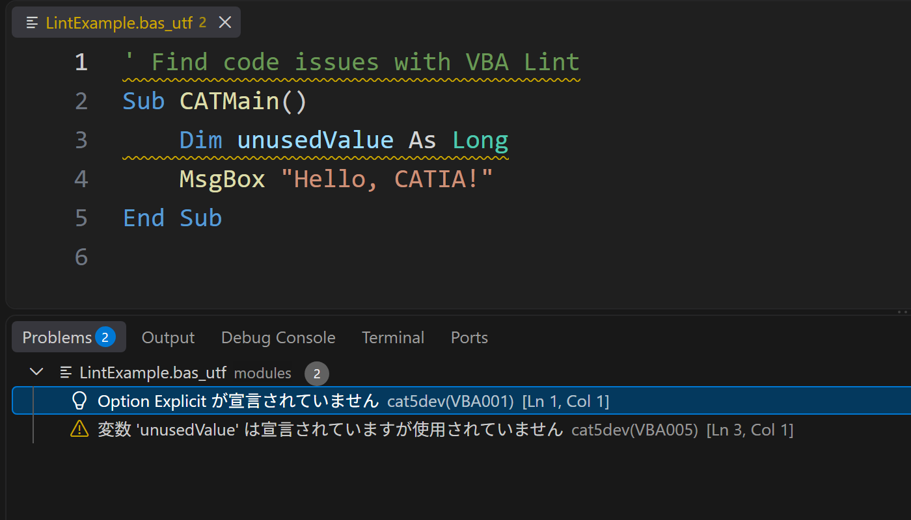

# Lint and Formatter

[← Back to README](../../README.md)

Both are **disabled by default**. Enable them in `cat5dev.toml` at the workspace root (if you do not have `cat5dev.toml`, see [Configuration](configuration.md) to create it).

Changes to `cat5dev.toml` take effect as soon as you save the file (no need to reload VSCode).

---

## VBA Lint

Code is checked when a file is opened, when it is edited (0.5 seconds after you stop typing), and when it is saved. Problems are shown as squiggles in the editor and in the Problems panel. The source shown in the Problems panel is `cat5dev`.



Some lint diagnostic messages are currently displayed in Japanese.

### Enabling Lint
```toml
[lint]
enabled = true
```

> [!NOTE]
> The `cat5dev.toml` created by `CATIA: Initialize Project (cat5dev.toml)` contains `enabled = false`. Change it to `true` to use Lint.

### Rules
| Code | Description | Severity | `[lint.rules]` key | Default |
|------|-------------|----------|--------------------|---------|
| VBA001 | `Option Explicit` is not declared | Warning | `option_explicit` | `true` |
| VBA002 | `On Error Resume Next` is used | Warning | `on_error_resume_next` | `false` |
| VBA003 | `GoTo` is used (`On Error GoTo` is excluded) | Warning | `goto` | `false` |
| VBA004 | Line is too long | Warning | `max_line_length` | `100` (characters; `0` disables) |
| VBA005 | Variable declared with `Dim` is not used | Warning | `unused_variables` | `true` |
| VBA006 | Nesting is too deep | Warning | `max_nesting_depth` | `5` (`0` disables) |
| VBA007 | `Sub` / `Function` has too many lines | Warning | `max_function_lines` | `300` (lines; `0` disables) |
| VBA008 | Unmatched parentheses | Error | `unmatched_parens` | `true` |
| VBA009 | Missing `End If` / `End Sub` / `End Function`, etc. | Error | `unmatched_blocks` | `true` |
| VBA010 | Characters that CATIA VBA cannot represent (emoji, etc.) ([below](#vba010-characters-that-catia-vba-cannot-represent)) | Warning | `non_ansi_character` | `true` |

`true` / `false` rules are disabled with `false`, and numeric rules are disabled with `0`.

```toml
[lint.rules]
option_explicit      = true
on_error_resume_next = false
goto                 = false
max_line_length      = 100
unused_variables     = true
max_nesting_depth    = 5
max_function_lines   = 300
unmatched_parens     = true
unmatched_blocks     = true
non_ansi_character   = true
ansi_code_page       = 0     # code page used by VBA010 (0 = detect automatically)
```

### VBA010: Characters that CATIA VBA cannot represent
CATIA VBA stores module text in the Windows system ANSI code page (code page 932 = Shift-JIS on Japanese Windows, 936 = GBK on Simplified Chinese Windows, and so on). Characters that this code page cannot represent are **silently replaced with `?` or another character when you Push** (see [Character encoding](sync.md#character-encoding)). VBA010 warns you about such characters before you Push.

```vba
MsgBox "Done🙂"   ' warning on 🙂: Push turns it into ?
```

- Characters are checked wherever they appear: identifiers, strings, and comments.
- Each character is checked by converting it to the code page and back; if the result differs, it is reported. Consecutive characters are combined into one warning, and the squiggle covers exactly those characters.
- Example message: `CATIA VBA (code page 932) cannot represent this character, so Push replaces it with ? or another character: 🙂`
- Examples for code page 932:

  | Warned | Not warned |
  |--------|------------|
  | Emoji (such as `🙂`), Hangul, `〜` (U+301C; Push turns it into `～`), `−` (U+2212), `¥` (becomes `\`), no-break space | Kanji, hiragana, katakana, half-width katakana (`ｱ`), circled numbers (`①`), `～` (full-width tilde U+FF5E), `㈱` |

  With code page 936, half-width katakana (`ｱ`) and similar characters are warned.

#### Code page used for the check
Set it with `ansi_code_page` in `[lint.rules]`.

| Value | Behavior |
|-------|----------|
| `0` (default) | Uses the system ANSI code page of this PC. When the extension starts, it reads `ACP` under the registry key `HKLM\SYSTEM\CurrentControlSet\Control\Nls\CodePage` once. If that fails, it estimates the code page from the VSCode display language (Chinese (Simplified) → 936, Chinese (Traditional) → 950, Korean → 949, others → 932) |
| `932`, `936`, etc. | Uses the specified code page. Set this when the PC running CATIA and the PC editing this workspace have different system code pages. You can also write `"cp936"` or `"auto"` (= `0`) |

- The code page in use is logged as one line in the "CATIA VBA Sync" output panel, such as `[vba-lint] System ANSI code page: 932 …`.
- Supported code pages are 874, 932, 936, 949, 950, and 1250–1258. For any other code page (for example 65001, used when Windows' "Beta: Use Unicode UTF-8 for worldwide language support" is enabled), VBA010 is disabled and a note is written to the output panel.
- If you change the Windows system locale, restart VSCode to detect it again.

> [!IMPORTANT]
> `ansi_code_page` is used **only for the VBA010 lint check**. It is unrelated to `encoding` in `[project]` (the encoding used for exchanging code with CATIA), which was removed in 0.7.0, and it does not change how Push / Pull work.

### Notes
- Messages of VBA001–VBA009 are always shown in Japanese, regardless of the display language setting. VBA010 messages follow the display language (Japanese, English, or Chinese).
- VBA005 checks only the first variable of a `Dim` statement (only `a` in `Dim a, b`). It covers `Dim` inside procedures; `Private` / `Public` / `Static` declarations are not checked.
- VBA006 counts the procedure itself as one level. `Select Case` counts as two levels.
- Nonexistent member detection (source `vba-ls`) is a separate feature from Lint. See [IntelliSense](intellisense.md#nonexistent-member-detection).

---

## VBA Formatter

Formats your code. It runs on VSCode's "Format Document" (`Shift+Alt+F`). You can also configure it to format on save and on Pull.

### Enabling the formatter
```toml
[formatter]
enabled = true
```

### What it does by default
| Operation | Example | Key |
|-----------|---------|-----|
| Capitalize keywords | `dim` → `Dim`, `end if` → `End If` | `capitalize_keywords` |
| Fix indentation | Blocks such as `Sub` / `If` / `For` / `Do` / `With` / `Select Case` | `fix_indentation` |
| Remove trailing whitespace | | `trim_trailing_space` |
| Add a space before the line continuation `_` | `Show(_` → `Show( _` | `ensure_continuation_space` |
| Indent continuation lines | Indents the line after a line ending in `_` by one level | `indent_continuation_lines` |
| Clean up blank lines | Limits consecutive blank lines to 2 | `max_blank_lines` |

- The indent unit is `indent_size` (default: 4 spaces).
- Inside `Select Case`, `Case` is indented one level and its body two levels. A single-line `If … Then …` is not treated as a block.
- Continuation line indentation works only when `fix_indentation = true`. Lines containing only `)` or `]` are not indented.
- Blank line cleanup inserts one blank line when the next procedure directly follows `End Sub`, etc. `max_blank_lines = 0` turns off blank line cleanup entirely.
- Strings and comments are not changed.
- Formatted files use CRLF line endings and end with a single newline.

### Options (disabled by default)
| Key | Example |
|-----|---------|
| `normalize_operator_spacing` | `x=1+2` → `x = 1 + 2` |
| `normalize_comma_spacing` | `foo(a,b)` → `foo(a, b)` |
| `normalize_comment_space` | `'comment` → `' comment` |
| `expand_type_suffixes` | `Dim x%` → `Dim x As Integer` |

### All keys and defaults
```toml
[formatter]
enabled = false                    # true to enable
indent_size = 4
capitalize_keywords = true
fix_indentation = true
trim_trailing_space = true
ensure_continuation_space = true
indent_continuation_lines = true
max_blank_lines = 2                # 0 = disabled
normalize_operator_spacing = false
normalize_comma_spacing = false
normalize_comment_space = false
expand_type_suffixes = false
format_on_save = false             # format on save
format_on_pull = false             # format files imported by Pull
```

### When formatting runs
| When | Condition |
|------|-----------|
| `Shift+Alt+F` (Format Document) | `enabled = true` |
| On file save | `enabled = true` and `format_on_save = true` |
| On Pull | `enabled = true` and `format_on_pull = true` |

- Formatting only a selection ("Format Selection") is not supported. The whole file is always formatted.
- If VSCode's `editor.formatOnSave` is enabled, files are formatted on save regardless of `format_on_save` (when `enabled = true`).
- All formatter settings go in the `[formatter]` section of `cat5dev.toml`. The VSCode Settings editor has no formatter settings.

### Command-line usage
The formatter binary `vbafmt.exe` (in the `bin/` folder of the extension) can also be used as a standalone command. It takes one file (or standard input) and writes the formatted result to standard output. It does not read `cat5dev.toml`; specify options as arguments (run `vbafmt.exe -h` for the list).

```bat
vbafmt.exe modules\Module1.bas_utf > Module1_formatted.bas_utf
vbafmt.exe --normalize-comma-spacing modules\Module1.bas_utf
vbafmt.exe --check modules\Module1.bas_utf   :: exit code 1 if formatting is needed (for CI)
```
