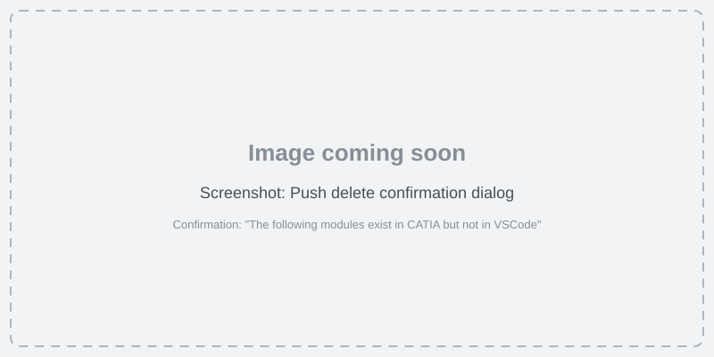
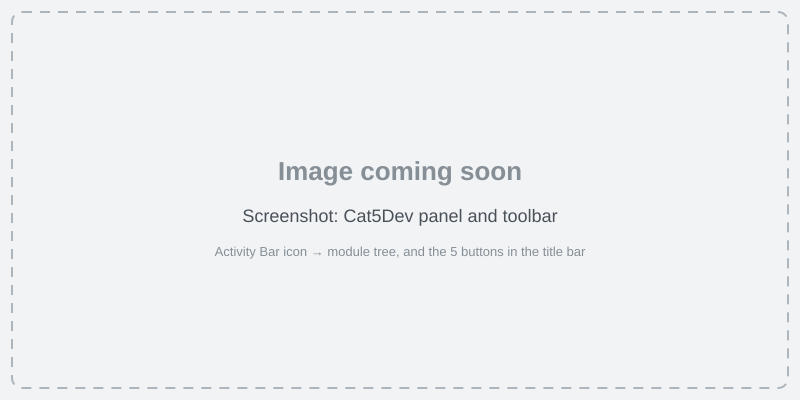

# Syncing with CATIA (Pull / Push)

[← Back to README](../../README.md)

Cat5Dev transfers modules between a CATIA V5 VBA project and the `modules/` folder in your workspace.

- [Selecting the target project](#selecting-the-target-project)
- [Pull (CATIA → VSCode)](#pull-catia--vscode)
- [Push (VSCode → CATIA)](#push-vscode--catia)
- [Module tree](#module-tree)
- [Preventing concurrent operations and the sync lock](#preventing-concurrent-operations-and-the-sync-lock)
- [Character encoding](#character-encoding)

---

## Selecting the target project

Click the ⚙️ button at the top of the panel (`CATIA: Select Target Project`) to see a list of the VBA projects open in CATIA. The selected name is saved as `target_project` in the `[project]` section of `cat5dev.toml`.

> [!IMPORTANT]
> Without `cat5dev.toml`, the selected project name is **not saved** (the message "Target VBA project set to …" appears, but the tree stays empty). Run `CATIA: Initialize Project (cat5dev.toml)` from the Command Palette first to create `cat5dev.toml`.

- If you run Pull / Push with no target project set, this selection list opens first.
- Project names are matched case-sensitively.

---

## Pull (CATIA → VSCode)

The ☁️↓ button at the top of the panel (`CATIA: Pull VBA Modules`) imports the modules of the target project into the `modules/` folder.

### What is pulled
| Type | Saved as |
|------|----------|
| Standard module | `modules/<name>.bas_utf` |
| Class module | `modules/<name>.cls_utf` |
| UserForm | `modules/<name>.frm_utf` (code only) |

- Other types, such as document modules, are not pulled.
- Only the code of UserForms is pulled. The form design (control layout) and `.frx` files are not handled.
- Files are saved as UTF-8 (no BOM) with LF line endings.
- The destination is always `modules/` (it cannot be changed). The folder is created if it does not exist.

### How it works
1. If any file in `modules/` has **unsaved edits**, Pull stops (save them first).
2. The modules are retrieved from CATIA.
3. If some files exist only locally (not in CATIA), a confirmation dialog appears.
   - **Yes (Delete)** — Deletes those files so the folder matches CATIA.
   - **No (Keep)** — Keeps those files and only updates and adds.
   - Close the dialog — Cancels the whole Pull.
4. Only files whose content changed are written. There is no overwrite confirmation.
5. When finished, the tree is refreshed.

### Safety net on failure
- Before writing, a temporary folder `.cat5dev-pull-XXXXXX/` is created in the workspace and the original files are backed up.
- If Pull fails partway, or local files change during Pull, the files are restored from the backup.
- On success, the temporary folder is deleted.

> [!WARNING]
> If the restore itself also fails, the `.cat5dev-pull-XXXXXX/` folder remains and its location is shown in the error message. **Do not delete this folder** until you have restored your files from the `backup/` folder inside it.

### Formatting on Pull
If you write `enabled = true` and `format_on_pull = true` in the `[formatter]` section of `cat5dev.toml`, pulled files are formatted by the formatter before they are saved (see [Lint and Formatter](lint-format.md)). Formatted files use CRLF line endings.

---

## Push (VSCode → CATIA)

The ☁️↑ button at the top of the panel (`CATIA: Push VBA Modules`) writes the modules in the `modules/` folder to CATIA.

### What is pushed
- `.bas_utf` / `.cls_utf` / `.frm_utf` files directly under `modules/` (subfolders are ignored)
- Each module is compared with the **current content** in CATIA, and only changed or added modules are sent. Differences in line endings, trailing whitespace, and BOM are not treated as changes.
- If nothing changed, the message "All modules (N) are unchanged since the last push. Skipped." appears and Push ends.
- What is sent is the **content saved on disk**.

### Steps and confirmation dialogs
1. **If there are unsaved edits** — A warning appears. Choose "Proceed" to send the saved content.
2. **Module name check**
   - Names longer than 31 characters trigger a warning (the VBA editor limit).
   - Names that are invalid in VBA, or duplicates that differ only in case, cause an error and Push stops.
3. **If some modules exist only in CATIA** — A confirmation dialog appears.

   

   - **Yes (Delete)** — Deletes them from CATIA too, so CATIA matches VSCode.
   - **No (Keep)** — Keeps those modules in CATIA.
   - Close the dialog — Cancels the whole Push.
4. **New UserForms** (no form with the same name in CATIA) cannot be created, so they are skipped with a warning. Create an empty UserForm with the same name in the CATIA VBA editor first, then push.
5. The modules are written to CATIA. Standard modules and class modules that do not exist in CATIA are created.

> [!CAUTION]
> **After pushing, always save the project in the CATIA VBA editor.**
> Push only writes to the VBA project in CATIA's memory. If you close CATIA without saving, all pushed changes are lost.

- If only some modules fail, the number of successes and failures is shown. Modules already written to CATIA are not rolled back. See "CATIA VBA Sync" in the Output panel for details.

---

## Module tree

Click the Cat5Dev icon in the Activity Bar to show the contents of the `modules/` folder in the side panel.

- The target project name is shown at the top. Nothing is shown when no target project is set.
- Below it, only the types that have files are shown, in this order:
  | Label | Type | Extension |
  |-------|------|-----------|
  | Forms | UserForm | `.frm_utf` |
  | Modules | Standard module | `.bas_utf` |
  | Class Modules | Class module | `.cls_utf` |
- Click a module to open it in the editor.
- The tree refreshes automatically when files in `modules/` or `cat5dev.toml` change. To refresh manually, click the 🔄 button.

### Toolbar buttons
| Icon | Command | Action |
|------|---------|--------|
| ☁️↓ | CATIA: Pull VBA Modules | Import from CATIA |
| ☁️↑ | CATIA: Push VBA Modules | Write to CATIA |
| ⚙️ | CATIA: Select Target Project | Select the target project |
| 🔄 | Refresh Modules | Refresh the tree |
| 🌐 | CATIA: Switch Language | Switch the display language |

### Context menu
| Menu | Action |
|------|--------|
| Rename | Renames the file (= the module name). The name must be valid in VBA and must not duplicate another module. A warning appears for UserForms (see below) |
| Delete | After confirmation, moves the file to the Recycle Bin |
| Copy Path | Copies the full path of the file to the clipboard |

- Files with unsaved edits cannot be renamed or deleted. Save them first.
- If you rename a UserForm, the next Push cannot create a form with the new name (step 4 above), and asks whether to delete the form with the old name. Choosing Delete loses the form design.

---

## Preventing concurrent operations and the sync lock

Operations that talk to CATIA (project selection, Pull, Push) can run **only one at a time** per Windows user. If one is already running in another VSCode window or workspace, the message "Another CATIA operation is running…" appears.

### If completion cannot be confirmed
If the CATIA operation does not finish within 60 seconds, or terminates abnormally, it is not treated as a success and the following message appears:

> CATIA completion could not be confirmed. Further operations are blocked. Check the state in CATIA.

In this case, the **sync lock** stays in place to prevent accidental double writes. If the CATIA operation finishes later, the lock is released automatically. If it is not released, recover as follows:

1. Save any necessary work in CATIA
2. Exit CATIA
3. In VSCode, run `Developer: Reload Window` from the Command Palette
4. Run `CATIA: Recover Synchronization Lock / 同期ロックを復旧` from the Command Palette

- For safety, recovery is refused if the VSCode window that started the original operation is still running, or if CATIA (`CNEXT.exe`) is still running.
- Lock information is stored in `%LOCALAPPDATA%\Cat5Dev\operation-lock\`.

For the detailed developer specification, see [synchronization-safety.md](../synchronization-safety.md).

---

## Character encoding

Files on the VSCode side are UTF-8, while VBA in CATIA uses an ANSI code page such as Shift-JIS or GBK. Cat5Dev converts between them during Pull / Push.

| `language` in `cat5dev.toml` | Default encoding |
|------------------------------|------------------|
| `"zh"` | `gbk` |
| `"ja"` / `"en"` | `shift_jis` |

You can change it with `encoding` in the `[project]` section (e.g. `encoding = "gb2312"`). If text is garbled, check this setting.
