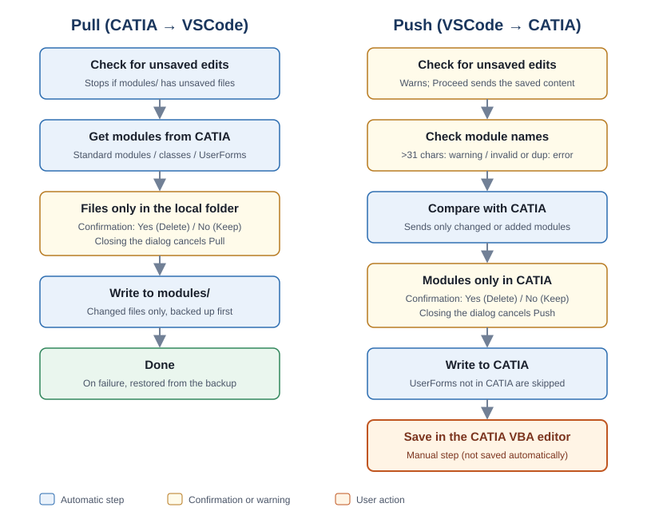
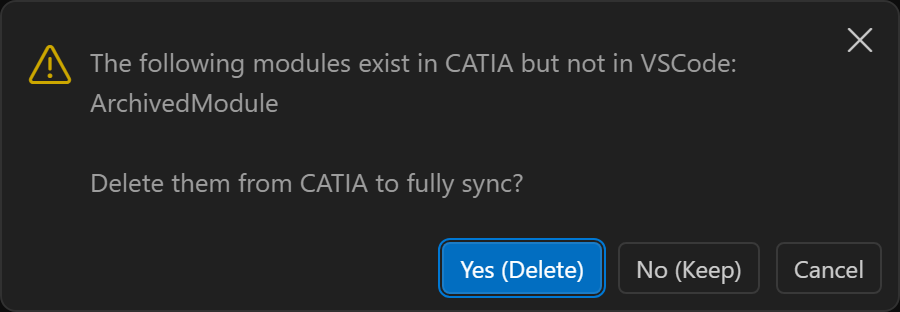
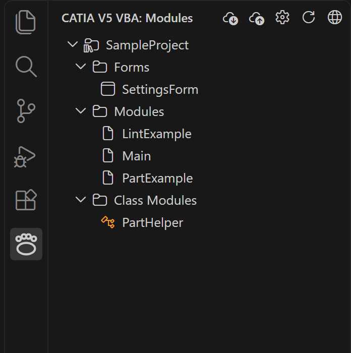

# Syncing with CATIA (Pull / Push)

[← Back to README](../../README.md)

Cat5Dev transfers modules between a CATIA V5 VBA project and the `modules/` folder in your workspace.

- [Selecting the target project](#selecting-the-target-project)
- [Pull (CATIA → VSCode)](#pull-catia--vscode)
- [Push (VSCode → CATIA)](#push-vscode--catia)
- [Module tree](#module-tree)
- [How Cat5Dev talks to CATIA](#how-cat5dev-talks-to-catia)
- [Preventing concurrent operations and the sync lock](#preventing-concurrent-operations-and-the-sync-lock)
- [Character encoding](#character-encoding)

---

## Selecting the target project

Click the ⚙️ button at the top of the panel (`CATIA: Select Target Project`) to see a list of the VBA projects open in CATIA. The selected name is saved as `target_project` in the `[project]` section of `cat5dev.toml`.

> [!IMPORTANT]
> Without `cat5dev.toml`, the selected project name is **not saved** (the message "Target VBA project set to …" appears, but the tree stays empty). Run `CATIA: Initialize Project (cat5dev.toml)` from the Command Palette first to create `cat5dev.toml`.

- If you run Pull / Push with no target project set, this selection list opens first.
- Project names are matched case-sensitively.

---

## Pull (CATIA → VSCode)

The ☁️↓ button at the top of the panel (`CATIA: Pull VBA Modules`) imports the modules of the target project into the `modules/` folder.

### What is pulled
| Type | Saved as |
|------|----------|
| Standard module | `modules/<name>.bas_utf` |
| Class module | `modules/<name>.cls_utf` |
| UserForm | `modules/<name>.frm_utf` (code only) |

- Other types, such as document modules, are not pulled.
- Only the code of UserForms is pulled. The form design (control layout) and `.frx` files are not handled.
- Files are saved as UTF-8 (no BOM) with LF line endings.
- The destination is always `modules/` (it cannot be changed). The folder is created if it does not exist.

### How it works
1. If any file in `modules/` has **unsaved edits**, Pull stops (save them first).
2. The modules are retrieved from CATIA.
3. If some files exist only locally (not in CATIA), a confirmation dialog appears.
   - **Yes (Delete)** — Deletes those files so the folder matches CATIA.
   - **No (Keep)** — Keeps those files and only updates and adds.
   - Close the dialog — Cancels the whole Pull.
4. Only files whose content changed are written. There is no overwrite confirmation.
5. When finished, the tree is refreshed.

### Safety net on failure
- Before writing, a temporary folder `.cat5dev-pull-XXXXXX/` is created in the workspace and the original files are backed up.
- If Pull fails partway, or local files change during Pull, the files are restored from the backup.
- On success, the temporary folder is deleted.

> [!WARNING]
> If the restore itself also fails, the `.cat5dev-pull-XXXXXX/` folder remains and its location is shown in the error message. **Do not delete this folder** until you have restored your files from the `backup/` folder inside it.

### Formatting on Pull
If you write `enabled = true` and `format_on_pull = true` in the `[formatter]` section of `cat5dev.toml`, pulled files are formatted by the formatter before they are saved (see [Lint and Formatter](lint-format.md)). Formatted files use CRLF line endings.

---

## Push (VSCode → CATIA)

The ☁️↑ button at the top of the panel (`CATIA: Push VBA Modules`) writes the modules in the `modules/` folder to CATIA.

### What is pushed
- `.bas_utf` / `.cls_utf` / `.frm_utf` files directly under `modules/` (subfolders are ignored)
- Each module is compared with the **current content** in CATIA, and only changed or added modules are sent. Differences in line endings, trailing whitespace, and BOM are not treated as changes.
- If nothing changed, the message "All modules (N) are unchanged since the last push. Skipped." appears and Push ends.
- What is sent is the **content saved on disk**.

### Steps and confirmation dialogs
1. **If there are unsaved edits** — A warning appears. Choose "Proceed" to send the saved content.
2. **Module name check**
   - Names longer than 31 characters trigger a warning (the VBA editor limit).
   - Names that are invalid in VBA, or duplicates that differ only in case, cause an error and Push stops.
3. **If some modules exist only in CATIA** — A confirmation dialog appears.

   

   - **Yes (Delete)** — Deletes them from CATIA too, so CATIA matches VSCode.
   - **No (Keep)** — Keeps those modules in CATIA.
   - Close the dialog — Cancels the whole Push.
4. **New UserForms** (no form with the same name in CATIA) cannot be created, so they are skipped with a warning. Create an empty UserForm with the same name in the CATIA VBA editor first, then push.
5. The modules are written to CATIA. Standard modules and class modules that do not exist in CATIA are created.

> [!CAUTION]
> **After pushing, always save the project in the CATIA VBA editor.**
> Push only writes to the VBA project in CATIA's memory. If you close CATIA without saving, all pushed changes are lost.

- If only some modules fail, the number of successes and failures is shown. Modules already written to CATIA are not rolled back. See "CATIA VBA Sync" in the Output panel for details.

---

## Module tree

Click the Cat5Dev icon in the Activity Bar to show the contents of the `modules/` folder in the side panel.

- The target project name is shown at the top. Nothing is shown when no target project is set.
- Below it, only the types that have files are shown, in this order:
  | Label | Type | Extension |
  |-------|------|-----------|
  | Forms | UserForm | `.frm_utf` |
  | Modules | Standard module | `.bas_utf` |
  | Class Modules | Class module | `.cls_utf` |
- Click a module to open it in the editor.
- The tree refreshes automatically when files in `modules/` or `cat5dev.toml` change. To refresh manually, click the 🔄 button.

### Toolbar buttons
| Icon | Command | Action |
|------|---------|--------|
| ☁️↓ | CATIA: Pull VBA Modules | Import from CATIA |
| ☁️↑ | CATIA: Push VBA Modules | Write to CATIA |
| ⚙️ | CATIA: Select Target Project | Select the target project |
| 🔄 | Refresh Modules | Refresh the tree |
| 🌐 | CATIA: Switch Language | Switch the display language |

### Context menu
| Menu | Action |
|------|--------|
| Rename | Renames the file (= the module name). The name must be valid in VBA and must not duplicate another module. A warning appears for UserForms (see below) |
| Delete | After confirmation, moves the file to the Recycle Bin |
| Copy Path | Copies the full path of the file to the clipboard |

- Files with unsaved edits cannot be renamed or deleted. Save them first.
- If you rename a UserForm, the next Push cannot create a form with the new name (step 4 above), and asks whether to delete the form with the old name. Choosing Delete loses the form design.

---

## How Cat5Dev talks to CATIA

For project selection, Pull and Push, the bundled helper `catia-run.exe` connects to CATIA and temporarily loads a helper VBA project, **`C5D_Bridge`**, into CATIA. Modules are read and written through `C5D_Bridge`. VBScript (`.catvbs` or `cscript`) is not used.

- `C5D_Bridge` is removed from CATIA when each operation ends (Push loads and removes it once for the change check and once for the write).
- **You may therefore see `C5D_Bridge` in the project list of the VBA editor for a short time while an operation is running.** Leave it alone.
- `C5D_Bridge` is loaded read-only and is **never saved**. It does not appear in the project selection list.
- Your VBA projects are written only by Push, and only the modules of the target project.
- `C5D_Bridge` can see only the projects loaded in the VBA editor, so **open the VBA editor (`Alt+F11`) once before you Pull / Push**.
- Loading and removing `C5D_Bridge` adds about one second to each operation.

### Files in the `bridge` folder
The `C5D_Bridge` files that CATIA loads are kept in `%LOCALAPPDATA%\Cat5Dev\bridge\`.

#### What the folder contains
| File | Contents |
|------|----------|
| `C5D_Bridge-<8 characters>.catvba` | A read-only copy of the `C5D_Bridge` bundled with the extension (about 155 KB), the original file. `<8 characters>` changes with each version of `C5D_Bridge`. The same file is reused as long as the version stays the same |
| `C5D_Bridge-<8 characters>-<CATIA process ID>-<date and time>.catvba` | Created each time Cat5Dev talks to CATIA (twice for Push: once for the change check and once for the write) and loaded into CATIA. It is a hard link to the original file (a read-only copy if a hard link cannot be created) |

- A hard link shares its contents with the original file, so it uses almost no extra disk space. File Explorer shows each of them as about 155 KB, but together they use the space of one file. A copy uses about 155 KB each.

#### When the files are deleted
- When an operation ends, `C5D_Bridge` is removed from CATIA (it also disappears from the VBA editor). However, CATIA keeps the file in use until CATIA exits, so it cannot be deleted right away. While CATIA is running, a new file is therefore added at each operation.
- After CATIA exits, Cat5Dev automatically deletes the files that are no longer in use when the next project selection, Pull or Push starts.
- When an extension update changes the version of `C5D_Bridge`, the original file of the old version is deleted at the same time. The original file of the current version is kept.

#### Can I delete them myself?
- Yes, as long as CATIA is not running (you can even delete the whole folder). The original file is created again at the next operation.
- While CATIA is running, files in use cannot be deleted. There is no need to force it.

---

## Preventing concurrent operations and the sync lock

Operations that talk to CATIA (project selection, Pull, Push) can run **only one at a time** per Windows user. If one is already running in another VSCode window or workspace, the following message appears:

> Another CATIA operation is running, or its completion is unconfirmed. Try again after it finishes.

### If completion cannot be confirmed
If the CATIA operation does not finish within 60 seconds (for example, because a MsgBox or another dialog is left open in CATIA), or if `catia-run.exe` exits without returning a result, it is not treated as a success and the following message appears:

> CATIA completion could not be confirmed. Further operations are blocked. After closing any MsgBox in CATIA, use "Release Lock" shown on the next attempt to recover.

In this case, CATIA may still be working or may already have written its changes, so the **sync lock** is held to prevent accidental double writes. While it is held, project selection, Pull and Push do not run.

- If the CATIA operation finishes later and its result arrives, the lock is released automatically (`[CATIA] Late terminal result received` is logged in "CATIA VBA Sync" in the Output panel). A result that arrives late is not used as the outcome of the Pull or Push, so pull again if you need to check the contents in CATIA.
- If the operation is known to have failed before anything was written in CATIA, such as when CATIA is not running, the VBA editor has never been opened (no VBA project can be seen), the `C5D_Bridge` helper project cannot be prepared, or the previous `catia-run.exe` is still running (`catia-run.exe` exit codes 2, 10, 11, 13, 14 and 15), this message does not appear and the lock is released at once. Follow the message shown and try again.

#### Releasing the lock
If the lock is not released automatically, release it as follows:

1. Close any MsgBox or other dialog open in CATIA, and make sure the previous operation has finished
2. In the VSCode window that holds the lock, run project selection, Pull or Push again
3. The following warning appears; click "Release Lock"

   > The previous CATIA operation could not be confirmed, so the synchronization lock is held. Close any MsgBox in CATIA, then click "Release Lock".

4. A confirmation dialog opens. Read it, then click "Release Lock" (clicking "Cancel" keeps the lock held)

   > Make sure the dialogs in CATIA are closed and the previous operation has finished.
   >
   > If the previous operation runs later in CATIA after the lock is released, it may be applied twice. Release the lock?

5. When "The synchronization lock has been recovered." appears, run the original operation again (releasing the lock does not run it)

- Instead of running an operation again, you can also run `CATIA: Recover Synchronization Lock / 同期ロックを復旧` from the Command Palette; it releases the lock through the same confirmation dialog.
- **Do not release the lock while CATIA may still be working.** Releasing does not check whether CATIA is busy. If you release the lock and run again while a MsgBox is still open or a macro is still running, the previous operation may run later in CATIA and the same changes may be written twice.
- If the result of the previous operation arrives after you release the lock, it is ignored. It does not affect the lock of a newly started operation.
- The temporary folder of the released operation (`%TEMP%\cat5dev-…`) is kept for diagnostics.

#### If "Release Lock" is not shown
The "Release Lock" button appears only in one of the following cases:

- An operation run in that window ended with "CATIA completion could not be confirmed" and the window holds the lock
- The VSCode window that holds the lock has already been closed or reloaded

If an operation is running in this or another window, or the window that holds the lock is still open, the warning without a button ("Another CATIA operation is running, …") appears instead. If an operation is running, wait for it to finish and try again. If another window holds the lock, follow the steps above in that window, or close that window (or reload it with `Developer: Reload Window`); "Release Lock" then appears in the other windows as well.

If the recovery command shows the following message, do as it says: save any necessary work in CATIA, exit CATIA, reload the VSCode window that holds the lock with `Developer: Reload Window`, and run `CATIA: Recover Synchronization Lock / 同期ロックを復旧` again.

> The synchronization lock cannot be safely released. If the operation does not finish, close CATIA, reload this VSCode window, and run recovery again.

- Lock information is stored in `%LOCALAPPDATA%\Cat5Dev\operation-lock\`.

---

## Character encoding

Files on the VSCode side are UTF-8. Pull / Push exchange the module text with CATIA as Unicode (no temporary files, no conversion to Shift-JIS or any other code page). Characters that the system ANSI code page of Windows can represent (for example Japanese on Japanese Windows, where it is Shift-JIS) therefore always make the round trip unchanged.

Characters that the ANSI code page cannot represent (for example the emoji `🙂`), however, are replaced with `?` when VBA stores them in the module. This is how VBA works, and the same happens when you type them in the VBA editor. If you push such a character and pull again, it comes back as `?`. With lint enabled, [VBA010](lint-format.md#vba010-characters-that-catia-vba-cannot-represent) warns about such characters before you push.

- `encoding` in the `[project]` section of `cat5dev.toml` is no longer used. If an old `cat5dev.toml` still has it, it is ignored (no error). You may delete it.
- How the VBA editor displays the text after it reaches CATIA, and how it is stored when you save the project, depend on CATIA (VBA).
