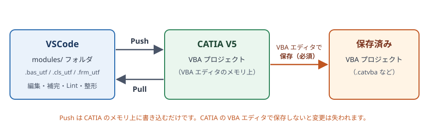
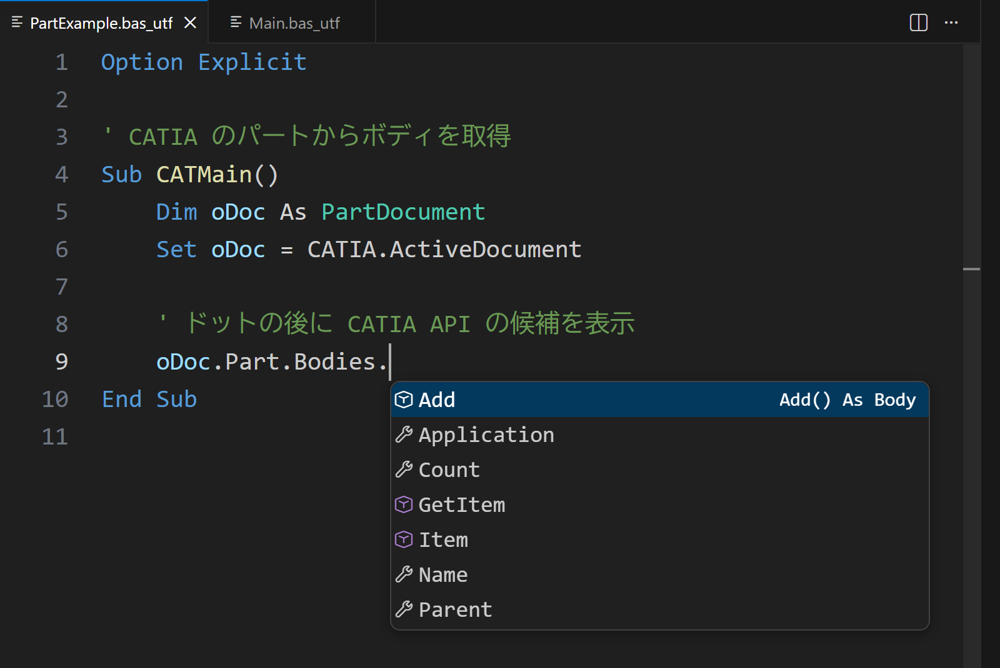
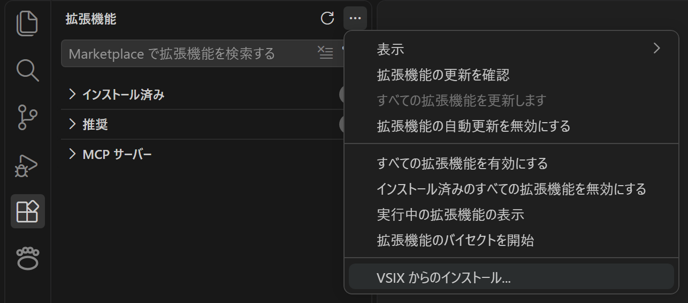
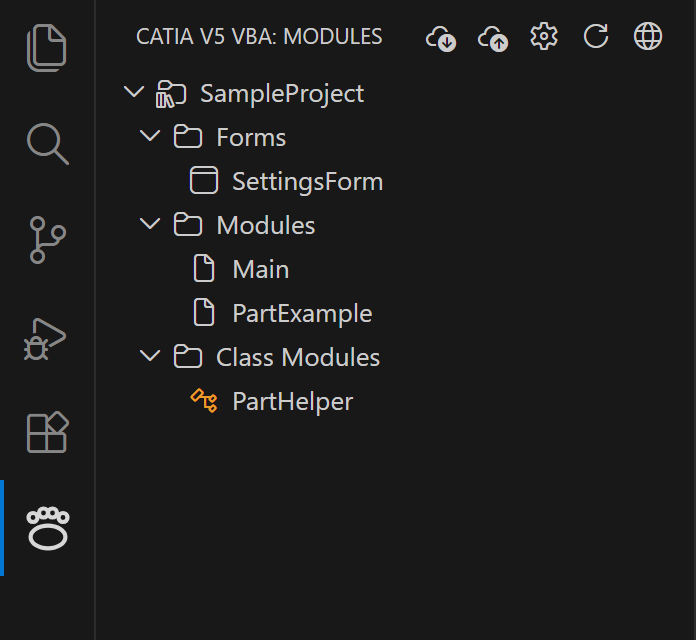

# Cat5Dev

[English](../../README.md) | 日本語 | [简体中文](../zh-CN/README.zh-CN.md)

Cat5Dev は、CATIA V5 の VBA マクロを VSCode で開発するための拡張機能です。
CATIA の VBA プロジェクトと VSCode の間でモジュールをやり取りし、VSCode 上で補完・Lint・整形を使って編集できます。

---

## 主な機能

| 機能 | 概要 | 詳細 |
|------|------|------|
| **Pull / Push** | CATIA の VBA プロジェクトと `modules/` フォルダの間でモジュールを同期。変更のあったものだけを送り、削除の前には確認 | [同期](sync.md) |
| **モジュールツリー** | サイドパネルにモジュールを種類別に表示。名前変更・削除・パスのコピー | [同期](sync.md#モジュールツリー) |
| **IntelliSense** | CATIA API を含むコード補完、ホバー、定義へ移動、引数のヒント、存在しないメンバーの検出 | [IntelliSense](intellisense.md) |
| **シンボルナビゲーション** | アウトライン、パンくずリスト、`Ctrl+Shift+O` でプロシージャへ移動 | [IntelliSense](intellisense.md#シンボルナビゲーション) |
| **VBA Lint** | `Option Explicit` 漏れ、未使用変数、`End If` の書き忘れなど 9 種類のルール（既定は無効） | [Lint とフォーマッタ](lint-format.md#vba-lint) |
| **VBA フォーマッタ** | キーワードの大文字化、インデント、空白・空行の整理（既定は無効） | [Lint とフォーマッタ](lint-format.md#vba-フォーマッタ) |
| **多言語表示** | 日本語・English・简体中文 | [設定](configuration.md#表示言語) |

---

## 動作環境

- Windows（64 ビット）
- CATIA V5 が起動しており、同期したい VBA プロジェクトが開かれていること
- **Pull / Push の前に、CATIA の VBA エディタ（`Alt+F11`）が起動していること**
- VSCode 1.85 以降

CATIA とは、同梱のヘルパー `catia-run.exe` を通じて COM で通信します。このヘルパーは Windows 10/11 に標準搭載の .NET Framework 4.x で動作します。

---

## インストール

Cat5Dev は `.vsix` ファイルで配布しています。

1. **`.vsix` ファイルをダウンロード**\
   [リリースページ](https://github.com/kantoku-code/Cat5Dev/releases) から `cat5dev-x.x.x.vsix` を取得します。

2. **VSCode にインストール**\
   拡張機能ビュー（`Ctrl+Shift+X`）を開き、右上の `⋯` メニューから **VSIX からのインストール...** を選びます。

   

3. **ファイルを選択**\
   ダウンロードした `.vsix` ファイルを選んでインストールします。

> [!WARNING]
> **初めて使う前に、CATIA V5 の設定フォルダをバックアップしてください。**\
> まれに CATIA の設定が壊れることがあります。バックアップがあれば元に戻せます。
>
> 1. `Win+R` を押して `%APPDATA%` と入力する
> 2. `Dassault Systemes\CATSettings` フォルダを開く
> 3. フォルダをコピーして、安全な場所（デスクトップ、OneDrive など）に貼り付ける
> 4. 名前を変えておく（例：`CATSettings_backup_2026-04-18`）

---

## はじめに

1. VSCode で作業用のフォルダを開きます。
2. コマンドパレット（`Ctrl+Shift+P`）から **`CATIA: Initialize Project (cat5dev.toml)`** を実行します。\
   設定ファイル `cat5dev.toml` と `.gitignore` が作成されます。
3. CATIA V5 を起動し、同期したい VBA プロジェクトを開きます。\
   **VBA エディタ（`Alt+F11`）も起動しておいてください。** VBA エディタが起動していないと Pull / Push はできません。
4. アクティビティバーの **CATIA V5 VBA** アイコンを押してパネルを開きます。
5. ⚙️ ボタンを押し、対象の VBA プロジェクトを選びます。
6. ☁️↓ ボタン（Pull）を押すと、モジュールが `modules/` フォルダに取り込まれます。
7. VSCode でコードを編集します。
8. ☁️↑ ボタン（Push）を押すと、変更が CATIA に送られます。
9. **CATIA の VBA エディタでプロジェクトを保存します**（下記の注意を参照）。

> [!TIP]
> Lint とフォーマッタは既定で無効です。使う場合は `cat5dev.toml` の `[lint]` と `[formatter]` で `enabled = true` にしてください（[Lint とフォーマッタ](lint-format.md)）。

---

## 重要：Push の後は CATIA の VBA エディタで保存してください

Push は CATIA のメモリ上の VBA プロジェクトに書き込むだけです。**保存しないまま CATIA を閉じると、Push した変更はすべて失われます。**\
VSCode から Push した後は、CATIA の VBA エディタで保存してください（`Ctrl+S`）。

また、Push では **VSCode 側に無いモジュールを CATIA から削除するかどうか** を確認されることがあります。内容をよく確認してから選んでください（[同期](sync.md#pushvscode--catia)）。

---

## ドキュメント

| ページ | 内容 |
|--------|------|
| [CATIA との同期](sync.md) | Pull / Push の動作と確認ダイアログ、モジュールツリー、同期ロックと復旧、文字コード |
| [IntelliSense](intellisense.md) | 補完・ホバー・定義へ移動・引数のヒント、型ヒント `'@As`、CATIA API の型情報 |
| [Lint とフォーマッタ](lint-format.md) | Lint のルール一覧、フォーマッタの処理内容とオプション |
| [設定リファレンス](configuration.md) | `cat5dev.toml` の全項目、表示言語、VSCode の設定、作成されるファイル |
| [トラブルシューティング](troubleshooting.md) | よくある問題と対処、出力パネルの見方 |

---

## 制限事項

- VSCode 上でのデバッグ実行はできません。デバッグには CATIA の VBA エディタを使ってください。
- ユーザーフォームはコードだけを扱います。フォームのデザイン（コントロールの配置）は CATIA の VBA エディタで編集してください。
- 新しいユーザーフォームは Push で作成できません。CATIA 側で同じ名前の空のフォームを先に作ってください。

---

## なぜ VBA なのか

CATIA V5 のマクロ開発をいくつかの言語で試してきましたが、最終的に VBA に戻ってきた理由がいくつかあります：

- **ネイティブサポート** — VBA は CATIA V5 に直接組み込まれています
- **最良の開発環境** — VBE は今でも最も充実した安定した選択肢です
- **驚くほど速い** — 多くのケースで VBA が他の選択肢を上回りました
- **コンパクトな配布** — 外部ランタイムや依存関係が不要です

VBA という言語が好きかどうか？\
それはまた別の話です。

---

## ライセンス

MIT
