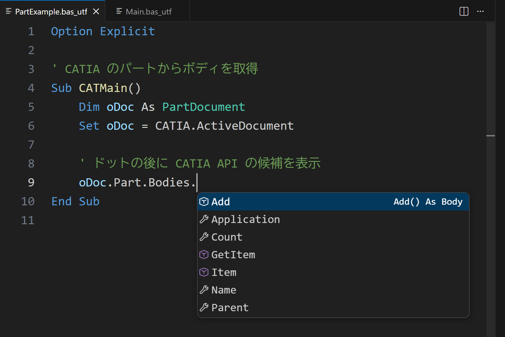
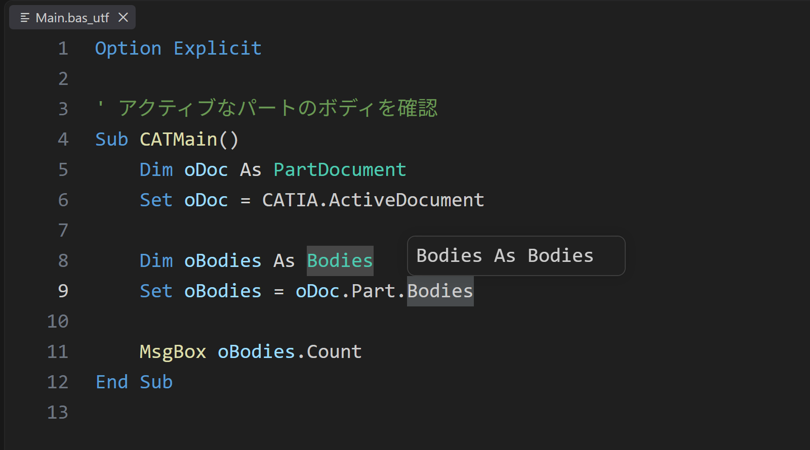

# IntelliSense（補完・ホバー・定義へ移動）

[← README に戻る](README.ja.md)

Cat5Dev には VBA 用の言語サーバー（`vba-ls`）が入っており、`.bas_utf` / `.cls_utf` / `.frm_utf` ファイルの編集中に次の機能が使えます。設定は不要です。

| 機能 | 使い方 |
|------|--------|
| [コード補完](#コード補完) | 入力中に自動表示、または `Ctrl+Space` |
| [ホバー](#ホバー) | 識別子にマウスを重ねる |
| [定義へ移動](#定義へ移動) | `F12` または `Ctrl+クリック` |
| [引数のヒント](#引数のヒント) | `(` `,` や空白の入力時に自動表示 |
| [型の色分け](#型の色分け) | 自動 |
| [存在しないメンバーの検出](#存在しないメンバーの検出) | 自動（波線と「問題」パネル） |
| [シンボルナビゲーション](#シンボルナビゲーション) | アウトライン・パンくずリスト・`Ctrl+Shift+O` |

CATIA V5 のオブジェクト（`Part`、`PartDocument`、`HybridShapeFactory` など）の型情報を内蔵しているため、CATIA のメソッドやプロパティも補完できます。

---

## コード補完



| 入力する場所 | 表示される候補 | 例 |
|--------------|----------------|-----|
| `.` の後 | その型のメソッド・プロパティ | `CATIA.ActiveDocument.` → `Document` のメンバー |
| `As ` / `New ` / `Implements ` の後 | 型の名前 | `Dim oPart As ` → `Part`, `Body`, … |
| `Exit ` / `End ` / `On Error ` / `Option ` などの後 | 続くキーワード | `End ` → `If`, `Sub`, `With`, … |
| それ以外 | 変数・プロシージャ・定数・キーワード | `oP` → `oPart`, … |

- **`.` の補完**は、`With` ブロック内の `.Foo`、`Me.`、配列や `Item` の結果、関数の戻り値、モジュール名（`Module1.`）でも使えます。
- **型の補完**は、自分で定義したクラス・ユーザー定義型・列挙型、VBA の型、CATIA の型の順に並びます。`New ` の後は作成できる型（クラス、`Collection`、`Dictionary` など）だけが出ます。`As MECMOD.` のようにライブラリ名で絞り込むこともできます。
- **識別子の補完**は、ローカル変数 → モジュール内の変数・プロシージャ → 他モジュールの Public なもの → VBA の関数・定数・CATIA の列挙値 → キーワード、の順に並びます。
- 文字列やコメントの中では補完しません。

---

## ホバー



識別子にマウスを重ねると、宣言や説明を表示します。

- **変数・プロシージャ** — 宣言の形（例：`Dim oPart As Part`、`Function GetName(ByVal n As Long) As String`）と、ドキュメントコメント
- **メンバー** — `x.Foo` の `Foo` のシグネチャ（例：`Add(Name As String) As Body`）
- **CATIA の型** — 型名、所属ライブラリ、継承関係（例：`PartDocument ← Document ← …`）
- **VBA の関数・定数** — シグネチャと説明

### ドキュメントコメント
宣言の**直前の行**に書いたコメントが、ホバーや補完の説明として表示されます。変数は行末のコメントでも構いません。

```vba
' 部品の名前を返す
' n: 部品の番号
Function GetName(ByVal n As Long) As String
    Dim oPart As Part   ' 作業中の部品
    ...
End Function
```

空行やコードを挟むと説明として扱われません。

---

## 定義へ移動

`F12`（または `Ctrl+クリック`）で、変数・プロシージャ・クラス・モジュールの定義場所に移動します。別のモジュールに書かれたものにも移動できます。

- モジュール名やクラス名の場合は、そのファイルの先頭に移動します。
- CATIA や VBA に組み込まれたものには定義の場所が無いため、移動しません。

---

## 引数のヒント

関数の `(` や `,` を入力すると、引数の一覧を表示し、いま入力している引数を強調します。

- 括弧を使わない呼び出し（`MsgBox "x", `、`Err.Raise ` など）にも対応します。
- 名前付き引数（`Title:=`）にも対応します。
- 引数の型が CATIA の列挙型の場合は、使える値を最大 10 個まで表示します。

---

## 型の色分け

型がオブジェクト（CATIA の型、`Collection`、自作クラスなど）の変数と、`As` の後の型名を、通常の変数とは別の色で表示します。`Long` や `String` などの基本型の変数は対象外です。

---

## 存在しないメンバーの検出

`.` の後に、その型に存在しないメソッドやプロパティを書くと、波線で知らせます。「問題」パネルの出所（ソース）は `vba-ls` です。

| 対象の型 | 重要度 | メッセージの例 |
|----------|--------|----------------|
| VBA の型、自作クラス・モジュール | エラー | `'clsFoo' に 'Bar' は存在しません` |
| CATIA の型 | 警告 | `'PartDocument' に 'Bogus' は存在しません（派生型を含む）` |

- CATIA の型は、宣言した型の**派生型**に存在するメンバーなら警告しません（例：`Dim d As Document` で `d.Part` は OK）。
- 構文エラーがあるモジュールや、ユーザーフォーム（コントロールの情報が無いため）は検査しません。
- この検出は `cat5dev.toml` の `[lint]` 設定とは別物で、無効にする設定はありません。

---

## 型ヒント `'@As`

`As Object` や `As Variant` で宣言した変数は型がわからないため、補完が出ません。たとえば `Set oDoc = CATIA.ActiveDocument` と代入しても型は推測されません。

このような変数には、宣言の**行末コメント**で型を指定できます。

```vba
Sub Main()
    Dim oDoc As Object '@As PartDocument
    Set oDoc = CATIA.ActiveDocument
    oDoc.Part.Bodies.          ' ← Bodies のメンバーが補完される

    Dim sel '@As Selection                 ' 型を書いていない変数にも使える
    Dim oBody As Object 'As MECMOD.Body    ' @ は省略可・ライブラリ名付きも可
End Sub
```

- 書式は `'@As 型名` または `'As 型名` です（大文字小文字は区別しません）。コメント全体がこの形である必要があります（`'As Part の説明` のように後ろに文字があると無視します）。
- `Dim` / `Static` / モジュールレベルの `Public` / `Private` に使えます。Public 変数に付けた型ヒントは、他のモジュールから使う場合にも有効です。
- 1 行に 1 つの変数を宣言している場合だけ有効です（`Dim a As Object, b As Object '@As Part` は無視）。
- `As Long` など型を明示した変数や、プロシージャの引数には使えません。
- 実際の宣言は変わりません。補完・ホバー・引数のヒント・検出・定義へ移動にだけ使われます。
- 型名が見つからない場合は無視されます。

> [!TIP]
> `Set x = New Foo` や `Set x = CreateObject("Scripting.Dictionary")` のように代入した、型を書いていない変数は、型ヒントが無くても型が推測されます。

---

## CATIA API の型情報

CATIA V5 の型情報は、同梱のデータベース `bin/catia_api.db` から読み込みます（CATIA V5 の 102 個のタイプライブラリから作成、メソッドやプロパティの**説明文は含みません**）。

### 説明文を表示したい場合
お手元の CATIA に付属するヘルプ（`V5Automation.chm`）から、説明文付きのデータベースを作成できます。

1. [tools/tlb-extractor/README.md](../../tools/tlb-extractor/README.md) の手順でデータベースを作成する
2. 環境変数 `CAT5DEV_TLB_DB` に、作成したデータベースのフルパスを設定する
3. VSCode を再起動する

> [!NOTE]
> 説明文は Dassault Systèmes の著作物です。作成したデータベースを共有したり、リポジトリにコミットしたりしないでください。

---

## モジュールをまたぐ機能

ワークスペースの `modules/` フォルダ直下のファイルを読み込み、モジュール間で補完・ホバー・定義へ移動が使えます（`modules/` が無い場合はワークスペースのルート直下）。

- **標準モジュール** — Public なプロシージャや変数は、そのまま（`Foo`）でも、モジュール名付き（`Module1.Foo`）でも使えます。
- **クラスモジュール** — `Dim c As clsFoo` とすると、`c.` で Public なメンバーが補完されます。
- **ユーザーフォーム** — `frmMenu.` のようにフォーム名で使えます。ただし、フォーム上のコントロールは補完できません。
- ファイルの追加・削除・名前変更（Pull による変更も含む）は自動で反映されます。

---

## シンボルナビゲーション

- **アウトライン** — エクスプローラー下部の「アウトライン」に、ファイル内の `Sub` / `Function` / `Property Get/Let/Set` / `Type` / `Enum` を一覧表示します。
- **パンくずリスト** — エディタ上部に、カーソル位置のプロシージャ名を表示します。
- **シンボルへ移動**（`Ctrl+Shift+O`） — プロシージャ名を選んでジャンプします。

パンくずリストの並び順は `cat5dev.toml` で変更できます。

```toml
[editor]
breadcrumbs_sort = "name"   # position = 記述順 / name = 名前順 / type = 種類順
```

この値はワークスペース設定（`.vscode/settings.json`）の `breadcrumbs.symbolSortOrder` に書き込まれ、このワークスペースの全ファイルに適用されます。キーが無い場合はワークスペース設定を変更しません。

---

## 制限事項

- **型の推測は限定的です。** `Set x = 式` で型が決まるのは `New X` と `CreateObject("…")` だけです。それ以外は型を宣言するか、[型ヒント](#型ヒント-as) を使ってください。
- **CATIA のプロパティは基本の型を返します。** `CATIA.ActiveDocument.` で出るのは `Document` のメンバーで、`PartDocument` のメンバーではありません。`Dim oDoc As PartDocument` と宣言してください。
- **フォームのコントロール**は補完・検出の対象外です。
- **読み込むのは `modules/` 直下だけ**です。サブフォルダは対象外で、上限は 2,000 ファイルです。
- **同じ名前のモジュール**が複数あると、片方だけが使われます。
- 入力途中で構文エラーがあると、そのモジュールの一部の補完が一時的に出なくなることがあります。
- 参照の検索、名前の一括変更、コードアクションには対応していません。

うまく動かないときは [トラブルシューティング](troubleshooting.md#補完やホバーが表示されない) を参照してください。
