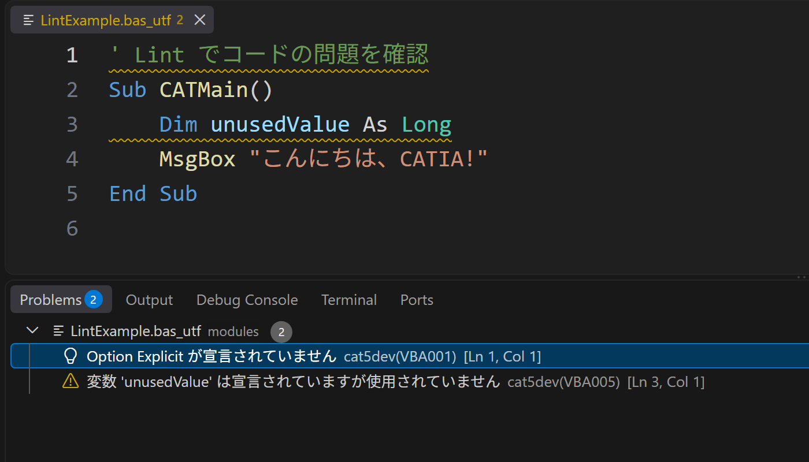

# Lint とフォーマッタ

[← README に戻る](README.ja.md)

どちらも**既定では無効**です。ワークスペースのルートにある `cat5dev.toml` で有効にします（`cat5dev.toml` が無い場合は [設定](configuration.md) を参照して作成してください）。

`cat5dev.toml` の変更は保存するとすぐに反映されます（VSCode の再読み込みは不要です）。

---

## VBA Lint

ファイルを開いたとき・編集したとき（入力が止まって 0.5 秒後）・保存したときにコードを検査し、問題をエディタの波線と「問題」パネルに表示します。「問題」パネルの出所（ソース）は `cat5dev` です。



### 有効にする
```toml
[lint]
enabled = true
```

> [!NOTE]
> `CATIA: Initialize Project (cat5dev.toml)` で作成した `cat5dev.toml` は `enabled = false` になっています。Lint を使うには `true` に書き換えてください。

### ルール一覧
| コード | 内容 | 重要度 | `[lint.rules]` のキー | 既定値 |
|--------|------|--------|------------------------|--------|
| VBA001 | `Option Explicit` が宣言されていない | 警告 | `option_explicit` | `true` |
| VBA002 | `On Error Resume Next` を使っている | 警告 | `on_error_resume_next` | `false` |
| VBA003 | `GoTo` を使っている（`On Error GoTo` は除く） | 警告 | `goto` | `false` |
| VBA004 | 行が長すぎる | 警告 | `max_line_length` | `100`（文字。`0` で無効） |
| VBA005 | `Dim` で宣言した変数を使っていない | 警告 | `unused_variables` | `true` |
| VBA006 | ネスト（入れ子）が深すぎる | 警告 | `max_nesting_depth` | `5`（`0` で無効） |
| VBA007 | `Sub` / `Function` の行数が多すぎる | 警告 | `max_function_lines` | `300`（行。`0` で無効） |
| VBA008 | 括弧の対応が取れていない | エラー | `unmatched_parens` | `true` |
| VBA009 | `End If` / `End Sub` / `End Function` などが足りない | エラー | `unmatched_blocks` | `true` |
| VBA010 | CATIA の VBA で表せない文字（絵文字など）がある（[下記](#vba010-catia-の-vba-で表せない文字)） | 警告 | `non_ansi_character` | `true` |

`true` / `false` のルールは `false` で無効、数値のルールは `0` で無効になります。

```toml
[lint.rules]
option_explicit      = true
on_error_resume_next = false
goto                 = false
max_line_length      = 100
unused_variables     = true
max_nesting_depth    = 5
max_function_lines   = 300
unmatched_parens     = true
unmatched_blocks     = true
non_ansi_character   = true
ansi_code_page       = 932   # VBA010 の判定に使うコードページ（言語の切り替えで書き換わる。0 = 自動検出）
```

### VBA010: CATIA の VBA で表せない文字
CATIA の VBA は、モジュールの本文を Windows のシステムの ANSI コードページ（日本語版 Windows ならコードページ 932 = Shift-JIS、簡体字中国語版なら 936 = GBK など）で保持します。そのコードページで表せない文字は、Push した時点で**何も知らせずに `?` など別の文字に置き換わります**（[文字コード](sync.md#文字コードエンコーディング) を参照）。VBA010 は、そのような文字を Push の前に警告します。

```vba
MsgBox "完了しました🙂"   ' 🙂 に警告: Push すると ? になる
```

- 識別子・文字列・コメントのどこにあっても対象です。
- 1 文字ずつ「コードページに変換して戻すと元の文字になるか」を調べます。続いている文字は 1 つの警告にまとめ、波線はその文字だけに付きます。
- メッセージ例: `この文字は CATIA の VBA（コードページ 932）で表せないため、Push すると ? などの別の文字に置き換わります: 🙂`
- コードページ 932 での例:

  | 警告になる | 警告にならない |
  |------------|----------------|
  | 絵文字（`🙂` など）、ハングル、`〜`（U+301C。Push すると `～` になる）、`−`（U+2212）、`¥`（`\` になる）、ノーブレークスペース | 漢字・ひらがな・カタカナ、半角カナ（`ｱ`）、丸数字（`①`）、`～`（全角チルダ U+FF5E）、`㈱` |

  コードページ 936 では、半角カナ（`ｱ`）などが警告になります。

#### 判定に使うコードページ
`[lint.rules]` の `ansi_code_page` で決めます。

`CATIA: Initialize Project (cat5dev.toml)` で作る `cat5dev.toml` には、表示言語に合わせた値（日本語 = 932 / 英語 = 1252 / 中国語 = 936）が書かれます。🌐 ボタンで表示言語を切り替えると、この値も切り替えた言語の値に書き換わります（手で書いた値や `0` も上書きされます）。英語の 1252（Windows-1252）は、英語版 CATIA の実機ではまだ確かめていません。

| 値 | 動作 |
|----|------|
| `0`（キーが無いときの既定） | この PC のシステムの ANSI コードページを使います。拡張機能の起動時に 1 回だけ、レジストリ `HKLM\SYSTEM\CurrentControlSet\Control\Nls\CodePage` の `ACP` を読み取ります。読み取れなかった場合は VSCode の表示言語から推定します（中国語（簡体字）→ 936、中国語（繁体字）→ 950、韓国語 → 949、英語 → 1252、それ以外 → 932） |
| `932` / `936` など | 指定したコードページを使います。CATIA を動かす PC と、このワークスペースを編集する PC とでシステムのコードページが違う場合に指定します。`"cp936"` や `"auto"`（= `0`）とも書けます |

- 使ったコードページは出力パネル「CATIA VBA Sync」に `[vba-lint] システムの ANSI コードページ: 932 …` のように 1 行記録されます。
- 対応しているコードページは 874・932・936・949・950・1250〜1258 です。それ以外（例: Windows の「ベータ: ワールドワイド言語サポートで Unicode UTF-8 を使用」を有効にしたときの 65001）では VBA010 を無効にし、出力パネルにその旨を記録します。
- Windows のシステムロケールを変えた場合は、VSCode を再起動すると検出し直します。

> [!IMPORTANT]
> `ansi_code_page` は **Lint の VBA010 の判定だけ**に使う設定です。0.7.0 で廃止された `[project]` の `encoding`（CATIA とやり取りするときの文字コード）とは別物で、Push / Pull の動作には影響しません。

### 注意点
- VBA001〜VBA009 のメッセージは表示言語の設定にかかわらず日本語です。VBA010 のメッセージは表示言語（日本語・英語・中国語）に従います。
- VBA005 は `Dim` の最初の変数だけを検査します（`Dim a, b` では `a` のみ）。プロシージャ内の `Dim` が対象で、`Private` / `Public` / `Static` の宣言は対象外です。
- VBA006 はプロシージャ自体を 1 段と数えます。`Select Case` は 2 段と数えます。
- VBA006 と VBA009 は文ごとに判定します。コロン（`:`）で区切った文（`For i = 1 To 3: x = i: Next` など）や、行継続（` _`）で複数行に分けた文も正しく扱います。
- VBA006 と VBA009 は、条件付きコンパイル（`#If` 〜 `#End If`）の最初の分岐だけを判定し、`#ElseIf` / `#Else` の分岐は読み飛ばします。`#If VBA7 Then` と `#Else` の両方に `Function` の宣言を書いても、二重に数えません。
- VBA009 は閉じ忘れたブロックの開始行に「'End If' がありません（開始: n 行目）」を出します。1 か所の閉じ忘れが後ろのブロックやプロシージャにまで波及しないようにしています。
- 存在しないメンバーの検出（ソース `vba-ls`）は Lint とは別の機能です。[IntelliSense](intellisense.md#存在しないメンバーの検出) を参照してください。

---

## VBA フォーマッタ

コードの書式を整えます。VSCode の「ドキュメントのフォーマット」（`Shift+Alt+F`）で動きます。設定すれば、ファイル保存時と Pull 時にも整形できます。

### 有効にする
```toml
[formatter]
enabled = true
```

### 既定で行う処理
| 処理 | 例 | キー |
|------|-----|------|
| キーワードの大文字化 | `dim` → `Dim`、`end if` → `End If` | `capitalize_keywords` |
| インデントの修正 | `Sub` / `If` / `For` / `Do` / `With` / `Select Case` などのブロック | `fix_indentation` |
| 行末の空白の削除 | | `trim_trailing_space` |
| 行継続 `_` の前に空白を入れる | `Show(_` → `Show( _` | `ensure_continuation_space` |
| 継続行のインデント | `_` で終わる行の次の行を 1 段下げる | `indent_continuation_lines` |
| 空行の整理 | 連続する空行を 2 行までにする | `max_blank_lines` |

- インデントの単位は `indent_size`（既定 4 スペース）です。
- `Select Case` の中は `Case` が 1 段、その中身が 2 段下がります。1 行で書いた `If … Then …` はブロックとして扱いません。
- 継続行のインデントは `fix_indentation = true` のときだけ働きます。`)` や `]` だけの行は下げません。
- 空行の整理では、`End Sub` などの直後に次のプロシージャが続いている場合に空行を 1 行入れます。`max_blank_lines = 0` にすると空行の整理をすべて行いません。
- 文字列とコメントの中は変更しません。
- 整形後のファイルは改行が CRLF になり、最後に改行が 1 つ付きます。

### オプション（既定では無効）
| キー | 例 |
|------|-----|
| `normalize_operator_spacing` | `x=1+2` → `x = 1 + 2` |
| `normalize_comma_spacing` | `foo(a,b)` → `foo(a, b)` |
| `normalize_comment_space` | `'comment` → `' comment` |
| `expand_type_suffixes` | `Dim x%` → `Dim x As Integer` |

### 全項目と既定値
```toml
[formatter]
enabled = false                    # true で有効
indent_size = 4
capitalize_keywords = true
fix_indentation = true
trim_trailing_space = true
ensure_continuation_space = true
indent_continuation_lines = true
max_blank_lines = 2                # 0 = 無効
normalize_operator_spacing = false
normalize_comma_spacing = false
normalize_comment_space = false
expand_type_suffixes = false
format_on_save = false             # 保存時に整形
format_on_pull = false             # Pull で取り込んだファイルを整形
```

### 整形のタイミング
| タイミング | 条件 |
|------------|------|
| `Shift+Alt+F`（ドキュメントのフォーマット） | `enabled = true` |
| ファイル保存時 | `enabled = true` かつ `format_on_save = true` |
| Pull 時 | `enabled = true` かつ `format_on_pull = true` |

- 選択範囲だけの整形（「選択範囲のフォーマット」）には対応していません。常にファイル全体を整形します。
- VSCode の `editor.formatOnSave` を有効にしていると、`format_on_save` の値に関係なく保存時に整形されます（`enabled = true` のとき）。
- フォーマッタの設定はすべて `cat5dev.toml` の `[formatter]` に書きます。VSCode の設定画面にフォーマッタの項目はありません。

### コマンドラインで使う
フォーマッタ本体 `vbafmt.exe`（拡張機能フォルダの `bin/` にあります）は単体のコマンドとしても使えます。ファイル（または標準入力）を 1 つ受け取り、整形結果を標準出力に書き出します。`cat5dev.toml` は読まず、オプションは引数で指定します（一覧は `vbafmt.exe -h`）。

```bat
vbafmt.exe modules\Module1.bas_utf > Module1_formatted.bas_utf
vbafmt.exe --normalize-comma-spacing modules\Module1.bas_utf
vbafmt.exe --check modules\Module1.bas_utf   :: 整形が必要なら終了コード 1（CI 向け）
```
