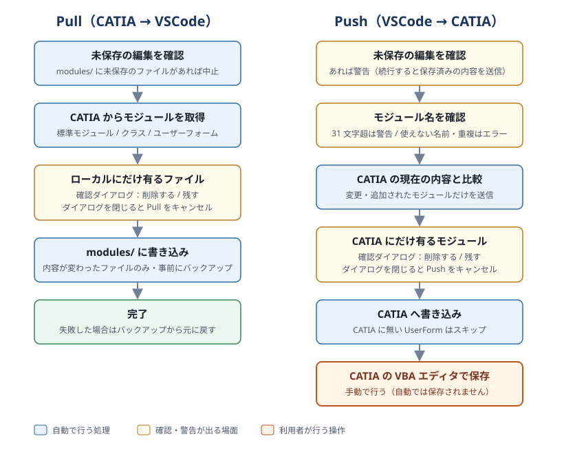
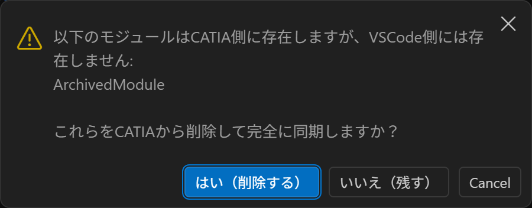
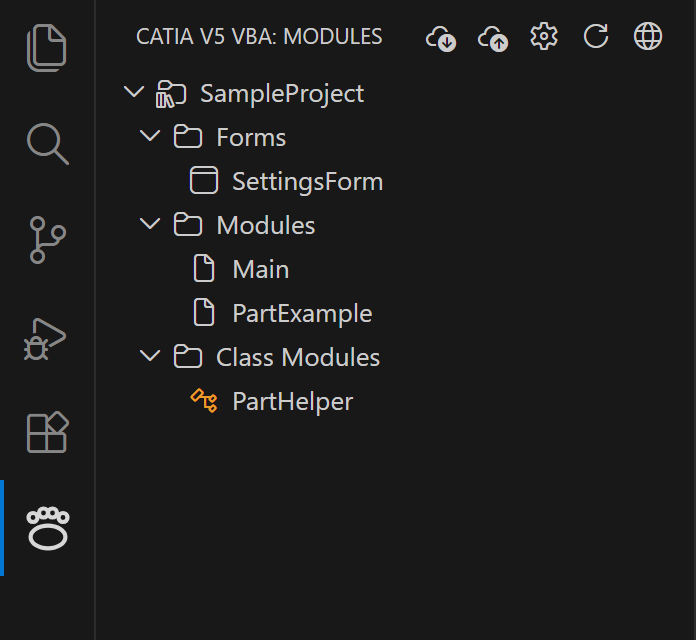

# CATIA との同期（Pull / Push）

[← README に戻る](README.ja.md)

Cat5Dev は CATIA V5 の VBA プロジェクトと、ワークスペースの `modules/` フォルダの間でモジュールをやり取りします。

- [対象プロジェクトの選択](#対象プロジェクトの選択)
- [Pull（CATIA → VSCode）](#pullcatia--vscode)
- [Push（VSCode → CATIA）](#pushvscode--catia)
- [モジュールツリー](#モジュールツリー)
- [CATIA とのやり取りの仕組み](#catia-とのやり取りの仕組み)
- [同時実行の防止と同期ロック](#同時実行の防止と同期ロック)
- [文字コード（エンコーディング）](#文字コードエンコーディング)

---

## 対象プロジェクトの選択

パネル上部の ⚙️ ボタン（`CATIA: Select Target Project`）を押すと、CATIA で開いている VBA プロジェクトの一覧が表示されます。選んだ名前は `cat5dev.toml` の `[project]` セクションの `target_project` に保存されます。

> [!IMPORTANT]
> `cat5dev.toml` が無い状態では、選んだプロジェクト名は**保存されません**（「設定しました」と表示されますが、ツリーは空のままです）。先にコマンドパレットから `CATIA: Initialize Project (cat5dev.toml)` を実行して `cat5dev.toml` を作成してください。

- 対象プロジェクトが未設定のまま Pull / Push を実行すると、先にこの選択画面が開きます。
- プロジェクト名は大文字と小文字を区別して照合します。

---

## Pull（CATIA → VSCode）

パネル上部の ☁️↓ ボタン（`CATIA: Pull VBA Modules`）で、対象プロジェクトのモジュールを `modules/` フォルダに取り込みます。

### 取り込まれるもの
| 種類 | 保存されるファイル |
|------|------------------|
| 標準モジュール | `modules/<名前>.bas_utf` |
| クラスモジュール | `modules/<名前>.cls_utf` |
| ユーザーフォーム | `modules/<名前>.frm_utf`（コード部分のみ） |

- ドキュメントモジュールなど、上記以外の種類は取り込みません。
- ユーザーフォームはコードだけを取り込みます。フォームのデザイン（コントロールの配置）や `.frx` ファイルは扱いません。
- ファイルは UTF-8（BOM なし）・改行 LF で保存されます。
- 保存先は `modules/` 固定です（変更できません）。フォルダが無ければ作成します。

### 動作の流れ
1. `modules/` 内に**未保存の編集**があるファイルがあれば中止します（先に保存してください）。
2. CATIA からモジュールを取得します。
3. ローカルにだけ存在するファイル（CATIA 側に無いもの）があれば、確認ダイアログを表示します。
   - **はい（削除する）** — それらのファイルを削除して CATIA と同じ状態にします。
   - **いいえ（残す）** — それらのファイルは残し、更新・追加だけ行います。
   - ダイアログを閉じる — Pull 全体をキャンセルします。
4. 内容が変わったファイルだけを書き込みます。上書きの確認はありません。
5. 完了するとツリーを更新します。

### 失敗したときの安全策
- 書き込みの前に、ワークスペースに一時フォルダ `.cat5dev-pull-XXXXXX/` を作り、元のファイルをバックアップします。
- 途中で失敗したり、Pull 中にローカルのファイルが変更されたりした場合は、バックアップから元に戻します。
- 正常に終わると一時フォルダは削除されます。

> [!WARNING]
> 元に戻す処理まで失敗した場合は、`.cat5dev-pull-XXXXXX/` フォルダが残り、その場所がエラーメッセージに表示されます。中の `backup/` からファイルを復元し終えるまで、**このフォルダは削除しないでください**。

### Pull 時の自動整形
`cat5dev.toml` の `[formatter]` で `enabled = true` と `format_on_pull = true` を書くと、取り込んだファイルをフォーマッタで整形してから保存します（[Lint とフォーマッタ](lint-format.md) を参照）。整形されたファイルは改行が CRLF になります。

---

## Push（VSCode → CATIA）

パネル上部の ☁️↑ ボタン（`CATIA: Push VBA Modules`）で、`modules/` フォルダのモジュールを CATIA に書き込みます。

### 送信されるもの
- `modules/` 直下の `.bas_utf` / `.cls_utf` / `.frm_utf` ファイル（サブフォルダは対象外）
- CATIA の**現在の内容**と比較し、変更・追加されたモジュールだけを送ります。改行コードの違い・末尾の空白・BOM の有無は差分として扱いません。
- 何も変わっていなければ「変更されていません」と表示して終了します。
- 送るのは**ディスクに保存された内容**です。

### 動作の流れと確認ダイアログ
1. **未保存の編集がある場合** — 警告を表示します。「続行」を選ぶと、保存済みの内容を送ります。
2. **モジュール名の確認**
   - 31 文字を超える名前があれば警告します（VBA エディタの上限）。
   - VBA で使えない名前や、大文字小文字違いの重複があるとエラーで中止します。
3. **CATIA にだけ存在するモジュールがある場合** — 確認ダイアログを表示します。

   

   - **はい（削除する）** — CATIA からも削除して、VSCode 側と同じ状態にします。
   - **いいえ（残す）** — CATIA 側のモジュールは残します。
   - ダイアログを閉じる — Push 全体をキャンセルします。
4. **新しいユーザーフォーム**（CATIA に同じ名前のフォームが無いもの）は作成できないため、警告を出してスキップします。先に CATIA の VBA エディタで同じ名前の空のユーザーフォームを作ってから Push してください。
5. CATIA に書き込みます。CATIA に無い標準モジュール・クラスモジュールは新しく作成されます。

> [!CAUTION]
> **Push の後は、必ず CATIA の VBA エディタでプロジェクトを保存してください。**
> Push は CATIA のメモリ上の VBA プロジェクトに書き込むだけです。保存しないまま CATIA を閉じると、Push した変更はすべて失われます。

- 一部のモジュールだけ失敗した場合は、成功・失敗の件数を表示します。CATIA に書き込み済みのモジュールは元に戻りません。詳細は出力パネルの「CATIA VBA Sync」で確認できます。

---

## モジュールツリー

アクティビティバーの Cat5Dev アイコンを押すと、サイドパネルに `modules/` フォルダの内容が表示されます。

- 一番上に対象プロジェクト名が表示されます。対象プロジェクトが未設定のときは何も表示されません。
- その下に、ファイルがある種類だけ次の順で表示されます（表示名は英語です）。
  | 表示名 | 種類 | 拡張子 |
  |--------|------|--------|
  | Forms | ユーザーフォーム | `.frm_utf` |
  | Modules | 標準モジュール | `.bas_utf` |
  | Class Modules | クラスモジュール | `.cls_utf` |
- モジュールをクリックするとエディタで開きます。
- `modules/` のファイルや `cat5dev.toml` が変わると、ツリーは自動で更新されます。手動で更新するときは 🔄 ボタンを押します。

### ツールバーのボタン
| アイコン | コマンド | 動作 |
|----------|----------|------|
| ☁️↓ | CATIA: Pull VBA Modules | CATIA から取り込む |
| ☁️↑ | CATIA: Push VBA Modules | CATIA へ書き込む |
| ⚙️ | CATIA: Select Target Project | 対象プロジェクトを選ぶ |
| 🔄 | Refresh Modules | ツリーを更新する |
| 🌐 | CATIA: Switch Language | 表示言語を切り替える |

### 右クリックメニュー
モジュールを右クリックすると表示されます（メニュー名は英語です）。

| メニュー | 動作 |
|----------|------|
| Rename（名前変更） | ファイル名（＝モジュール名）を変更します。VBA で使える名前で、他と重複しないことが必要です。ユーザーフォームの場合は警告が出ます（下記） |
| Delete（削除） | 確認のうえ、ファイルをごみ箱に移動します |
| Copy Path（パスをコピー） | ファイルのフルパスをクリップボードにコピーします |

- 未保存の編集があるファイルは、名前変更・削除ともに実行できません。先に保存してください。
- ユーザーフォームの名前を変えると、次の Push で新しい名前のフォームを作れず（上記 4.）、古い名前のフォームの削除確認が表示されます。削除を選ぶとフォームのデザインが失われます。

---

## CATIA とのやり取りの仕組み

プロジェクト選択・Pull・Push では、同梱のヘルパー `catia-run.exe` が CATIA に接続し、CATIA の中に仲介用の VBA プロジェクト **`C5D_Bridge`** を一時的に読み込みます。モジュールの読み書きは、この `C5D_Bridge` から行います。VBScript（`.catvbs` や `cscript`）は使いません。

- `C5D_Bridge` は、1 回の処理が終わると CATIA から外されます（Push では、差分の確認と書き込みのそれぞれで読み込んで外します）。
- そのため、**処理中の短い間だけ VBA エディタのプロジェクト一覧に `C5D_Bridge` が表示されることがあります**。触らずにそのままにしてください。
- `C5D_Bridge` は読み取り専用で読み込まれるため、**保存されません**。プロジェクト選択の一覧にも表示されません。
- 利用者の VBA プロジェクトに書き込むのは Push のときだけで、書き込むのは対象プロジェクトのモジュールだけです。
- `C5D_Bridge` から見えるのは、VBA エディタに読み込まれているプロジェクトです。そのため、**Pull / Push の前に VBA エディタ（`Alt+F11`）を一度開いておく必要があります**。
- 読み込みと取り外しのため、1 回の処理につき 1 秒ほどかかります。

### `bridge` フォルダのファイル
CATIA に読み込ませる `C5D_Bridge` のファイルは、`%LOCALAPPDATA%\Cat5Dev\bridge\` に置きます。

#### フォルダに何が入るか
| ファイル | 内容 |
|----------|------|
| `C5D_Bridge-<8 桁>.catvba` | 拡張機能に同梱の `C5D_Bridge`（約 155 KB）を、読み取り専用でコピーしたもの（元のファイル）。`<8 桁>` は `C5D_Bridge` の版ごとに変わります。同じ版のあいだは同じファイルを使い続けます |
| `C5D_Bridge-<8 桁>-<CATIA のプロセス ID>-<日時>.catvba` | CATIA とやり取りするたびに（Push では差分の確認と書き込みで 2 回）作り、CATIA に読み込ませるファイル。元のファイルへのハードリンクです（作れない場合は読み取り専用のコピー） |

- ハードリンクは元のファイルと中身を共有するため、ディスクはほとんど増えません。エクスプローラーではどれも約 155 KB と表示されますが、実際に使う領域は 1 つ分です。コピーになった場合は、1 つにつき約 155 KB を使います。

#### いつ消えるか
- 処理が終わると、`C5D_Bridge` は CATIA から外れます（VBA エディタからも消えます）。ただし CATIA は、外した後もそのファイルを CATIA の終了まで使用中のままにするため、すぐには削除できません。そのため、CATIA を起動している間は、処理のたびにファイルが増えていきます。
- CATIA を終了した後、次のプロジェクト選択・Pull・Push を始めるときに、使用中でなくなったファイルを Cat5Dev が自動で削除します。
- 拡張機能の更新で `C5D_Bridge` の版が変わったときは、古い版の元のファイルも同じときに削除します。今の版の元のファイルは残します。

#### 手動で消してよいか
- CATIA を終了していれば、手動で削除してかまいません（フォルダごと削除しても問題ありません）。元のファイルは、次の処理のときに作り直されます。
- CATIA の起動中は、使用中のファイルは削除できません。無理に消す必要はありません。

---

## 同時実行の防止と同期ロック

CATIA との通信（プロジェクト選択・Pull・Push）は、同じ Windows ユーザーで**同時に 1 つだけ**実行できます。別の VSCode ウィンドウやワークスペースで実行中のときは、次のように表示されます。

> 別のCATIA操作が実行中、または前回操作の終了を確認できません。終了後に再実行してください。

### 「完了を確認できません」と表示されたとき
CATIA の処理が 60 秒以内に終わらなかった場合（CATIA で MsgBox などのダイアログが開いたままになっているときなど）や、`catia-run.exe` が結果を返さずに終了した場合は、成功とはみなさず次のように表示します。

> CATIA操作の完了を確認できません。再操作を防止しています。CATIA側のMsgBox等を閉じた後、再実行時に表示される「ロック解除」で復旧できます。

このとき CATIA 側では処理が続いている、または書き込みが済んでいる可能性があるため、誤って二重に書き込まないよう**同期ロック**を保留したままにします。保留中は、プロジェクト選択・Pull・Push のどれも実行されません。

- 後から CATIA の処理が終わって結果が届けば、ロックは自動で外れます（出力パネルの「CATIA VBA Sync」に `[CATIA] Late terminal result received` と記録されます）。遅れて届いた結果は Pull の取り込みや Push の結果としては扱われないので、必要ならもう一度 Pull して CATIA 側の内容を確認してください。
- CATIA が起動していない、VBA エディタを一度も開いていない（VBA プロジェクトが見えない）、仲介プロジェクト `C5D_Bridge` を準備できない、前回の `catia-run.exe` がまだ実行中など、CATIA に何も書き込む前に失敗したと分かる場合（`catia-run.exe` の終了コード 2・10・11・13・14・15）は、このメッセージにはならず、ロックもすぐに外れます。それぞれのメッセージに従って再実行してください。

#### ロックを解除する手順
ロックが自動で外れない場合は、次の手順で解除します。

1. CATIA で開いている MsgBox などのダイアログを閉じ、前回の処理が終わったことを確かめる
2. ロックを保留した VSCode ウィンドウで、もう一度プロジェクト選択・Pull・Push のどれかを実行する
3. 次の警告が表示されるので、「ロック解除」を押す

   > 前回のCATIA操作の完了を確認できず、同期ロックが保留されています。CATIA側のMsgBox等を閉じてから「ロック解除」を押してください。

4. 確認ダイアログが開くので、内容を確かめてから「ロック解除」を押す（「キャンセル」を押すとロックは保留のままです）

   > CATIA側のダイアログが閉じられ、前回の操作が終わっていることを確認してください。
   >
   > ロックを解除すると、前回の処理が後からCATIAで実行された場合に重複する可能性があります。解除しますか？

5. 「同期ロックの復旧が完了しました。」と表示されたら、元の操作をもう一度実行する（解除しただけでは、元の操作は実行されません）

- 再実行の代わりに、コマンドパレットから `CATIA: Recover Synchronization Lock / 同期ロックを復旧` を実行しても、同じ確認ダイアログから解除できます。
- **CATIA がまだ処理中かもしれないときは、解除しないでください。** 解除するときに CATIA が動いているかどうかは確かめません。MsgBox が開いたまま、またはマクロが動いている間に解除して再実行すると、前回の処理が後から CATIA で実行され、同じ内容が二重に書き込まれることがあります。
- 解除した後に前回の結果が遅れて届いても、無視されます。新しく始めた操作のロックには影響しません。
- 解除した操作の一時フォルダ（`%TEMP%\cat5dev-…`）は、調査用に残します。

#### 「ロック解除」が表示されないとき
「ロック解除」のボタンが表示されるのは、次のどちらかの場合だけです。

- そのウィンドウで実行した操作が「完了を確認できません」で終わり、ロックを保留しているとき
- ロックを保留した VSCode ウィンドウが、既に閉じられているか再読み込みされているとき

このウィンドウや別のウィンドウで操作が実行中のときや、ロックを保留したウィンドウがまだ開いているときは、ボタンの無い警告（「別のCATIA操作が実行中、…」）になります。実行中の操作は終わるのを待ってから再実行してください。別のウィンドウでロックを保留している場合は、そのウィンドウで上の手順を行うか、そのウィンドウを閉じる（または `Developer: Reload Window` で再読み込みする）と、ほかのウィンドウでも「ロック解除」が表示されるようになります。

復旧コマンドで次のように表示された場合は、メッセージのとおり CATIA で必要な作業を保存して CATIA を終了し、ロックを保留した VSCode ウィンドウを `Developer: Reload Window` で再読み込みしてから、もう一度 `CATIA: Recover Synchronization Lock / 同期ロックを復旧` を実行してください。

> 同期ロックを安全に解除できません。実行中の操作が終了しない場合はCATIAを終了し、VSCodeウィンドウを再読み込みしてから復旧コマンドを実行してください。

- ロックの情報は `%LOCALAPPDATA%\Cat5Dev\operation-lock\` に保存されます。

---

## 文字コード（エンコーディング）

VSCode 側のファイルは UTF-8 です。Pull / Push では、モジュールの本文を Unicode のまま CATIA とやり取りします（一時ファイルや Shift-JIS などへの変換は使いません）。そのため、日本語など Windows のシステムの ANSI コードページ（日本語版 Windows では Shift-JIS）で表せる文字は、確実にそのまま往復します。

ただし、ANSI コードページで表せない文字（例：絵文字の `🙂`）は、VBA がモジュールに保存する時点で `?` に置き換わります。これは VBA の仕様で、VBA エディタに直接入力した場合と同じです。Push した後に Pull すると、その文字は `?` になって戻ってきます。Lint を有効にすると、このような文字を Push の前に [VBA010](lint-format.md#vba010-catia-の-vba-で表せない文字) で警告します。

- `cat5dev.toml` の `[project]` セクションの `encoding` は使われなくなりました。古い `cat5dev.toml` に残っていても無視されます（エラーにはなりません）。削除してもかまいません。
- CATIA に送った後の VBA エディタでの表示や、プロジェクトを保存したときの扱いは、CATIA（VBA）側の動作によります。
