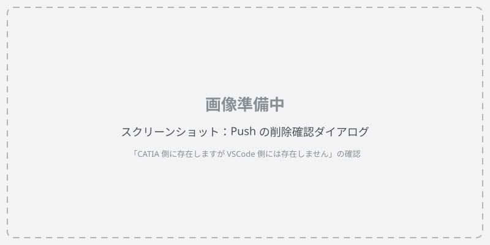
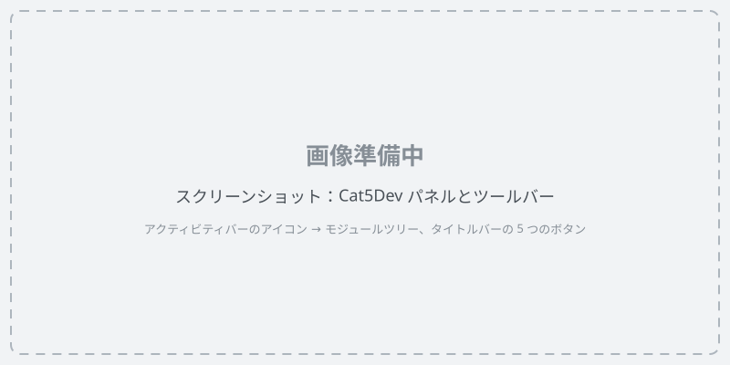

# CATIA との同期（Pull / Push）

[← README に戻る](../README.ja.md)

Cat5Dev は CATIA V5 の VBA プロジェクトと、ワークスペースの `modules/` フォルダの間でモジュールをやり取りします。

- [対象プロジェクトの選択](#対象プロジェクトの選択)
- [Pull（CATIA → VSCode）](#pullcatia--vscode)
- [Push（VSCode → CATIA）](#pushvscode--catia)
- [モジュールツリー](#モジュールツリー)
- [同時実行の防止と同期ロック](#同時実行の防止と同期ロック)
- [文字コード（エンコーディング）](#文字コードエンコーディング)

---

## 対象プロジェクトの選択

パネル上部の ⚙️ ボタン（`CATIA: Select Target Project`）を押すと、CATIA で開いている VBA プロジェクトの一覧が表示されます。選んだ名前は `cat5dev.toml` の `[project]` セクションの `target_project` に保存されます。

> [!IMPORTANT]
> `cat5dev.toml` が無い状態では、選んだプロジェクト名は**保存されません**（「設定しました」と表示されますが、ツリーは空のままです）。先にコマンドパレットから `CATIA: Initialize Project (cat5dev.toml)` を実行して `cat5dev.toml` を作成してください。

- 対象プロジェクトが未設定のまま Pull / Push を実行すると、先にこの選択画面が開きます。
- プロジェクト名は大文字と小文字を区別して照合します。

---

## Pull（CATIA → VSCode）

パネル上部の ☁️↓ ボタン（`CATIA: Pull VBA Modules`）で、対象プロジェクトのモジュールを `modules/` フォルダに取り込みます。

### 取り込まれるもの
| 種類 | 保存されるファイル |
|------|------------------|
| 標準モジュール | `modules/<名前>.bas_utf` |
| クラスモジュール | `modules/<名前>.cls_utf` |
| ユーザーフォーム | `modules/<名前>.frm_utf`（コード部分のみ） |

- ドキュメントモジュールなど、上記以外の種類は取り込みません。
- ユーザーフォームはコードだけを取り込みます。フォームのデザイン（コントロールの配置）や `.frx` ファイルは扱いません。
- ファイルは UTF-8（BOM なし）・改行 LF で保存されます。
- 保存先は `modules/` 固定です（変更できません）。フォルダが無ければ作成します。

### 動作の流れ
1. `modules/` 内に**未保存の編集**があるファイルがあれば中止します（先に保存してください）。
2. CATIA からモジュールを取得します。
3. ローカルにだけ存在するファイル（CATIA 側に無いもの）があれば、確認ダイアログを表示します。
   - **はい（削除する）** — それらのファイルを削除して CATIA と同じ状態にします。
   - **いいえ（残す）** — それらのファイルは残し、更新・追加だけ行います。
   - ダイアログを閉じる — Pull 全体をキャンセルします。
4. 内容が変わったファイルだけを書き込みます。上書きの確認はありません。
5. 完了するとツリーを更新します。

### 失敗したときの安全策
- 書き込みの前に、ワークスペースに一時フォルダ `.cat5dev-pull-XXXXXX/` を作り、元のファイルをバックアップします。
- 途中で失敗したり、Pull 中にローカルのファイルが変更されたりした場合は、バックアップから元に戻します。
- 正常に終わると一時フォルダは削除されます。

> [!WARNING]
> 元に戻す処理まで失敗した場合は、`.cat5dev-pull-XXXXXX/` フォルダが残り、その場所がエラーメッセージに表示されます。中の `backup/` からファイルを復元し終えるまで、**このフォルダは削除しないでください**。

### Pull 時の自動整形
VSCode の設定 `cat5dev.formatter.formatOnPull` を `true` にすると、取り込んだファイルをフォーマッタで整形してから保存します。`cat5dev.toml` の `[formatter] enabled = true` も必要です（[Lint とフォーマッタ](lint-format.md) を参照）。整形されたファイルは改行が CRLF になります。

---

## Push（VSCode → CATIA）

パネル上部の ☁️↑ ボタン（`CATIA: Push VBA Modules`）で、`modules/` フォルダのモジュールを CATIA に書き込みます。

### 送信されるもの
- `modules/` 直下の `.bas_utf` / `.cls_utf` / `.frm_utf` ファイル（サブフォルダは対象外）
- CATIA の**現在の内容**と比較し、変更・追加されたモジュールだけを送ります。改行コードの違い・末尾の空白・BOM の有無は差分として扱いません。
- 何も変わっていなければ「変更されていません」と表示して終了します。
- 送るのは**ディスクに保存された内容**です。

### 動作の流れと確認ダイアログ
1. **未保存の編集がある場合** — 警告を表示します。「続行」を選ぶと、保存済みの内容を送ります。
2. **モジュール名の確認**
   - 31 文字を超える名前があれば警告します（VBA エディタの上限）。
   - VBA で使えない名前や、大文字小文字違いの重複があるとエラーで中止します。
3. **CATIA にだけ存在するモジュールがある場合** — 確認ダイアログを表示します。

   

   - **はい（削除する）** — CATIA からも削除して、VSCode 側と同じ状態にします。
   - **いいえ（残す）** — CATIA 側のモジュールは残します。
   - ダイアログを閉じる — Push 全体をキャンセルします。
4. **新しいユーザーフォーム**（CATIA に同じ名前のフォームが無いもの）は作成できないため、警告を出してスキップします。先に CATIA の VBA エディタで同じ名前の空のユーザーフォームを作ってから Push してください。
5. CATIA に書き込みます。CATIA に無い標準モジュール・クラスモジュールは新しく作成されます。

> [!CAUTION]
> **Push の後は、必ず CATIA の VBA エディタでプロジェクトを保存してください。**
> Push は CATIA のメモリ上の VBA プロジェクトに書き込むだけです。保存しないまま CATIA を閉じると、Push した変更はすべて失われます。

- 一部のモジュールだけ失敗した場合は、成功・失敗の件数を表示します。CATIA に書き込み済みのモジュールは元に戻りません。詳細は出力パネルの「CATIA VBA Sync」で確認できます。

---

## モジュールツリー

アクティビティバーの Cat5Dev アイコンを押すと、サイドパネルに `modules/` フォルダの内容が表示されます。

- 一番上に対象プロジェクト名が表示されます。対象プロジェクトが未設定のときは何も表示されません。
- その下に、ファイルがある種類だけ次の順で表示されます（表示名は英語です）。
  | 表示名 | 種類 | 拡張子 |
  |--------|------|--------|
  | Forms | ユーザーフォーム | `.frm_utf` |
  | Modules | 標準モジュール | `.bas_utf` |
  | Class Modules | クラスモジュール | `.cls_utf` |
- モジュールをクリックするとエディタで開きます。
- `modules/` のファイルや `cat5dev.toml` が変わると、ツリーは自動で更新されます。手動で更新するときは 🔄 ボタンを押します。

### ツールバーのボタン
| アイコン | コマンド | 動作 |
|----------|----------|------|
| ☁️↓ | CATIA: Pull VBA Modules | CATIA から取り込む |
| ☁️↑ | CATIA: Push VBA Modules | CATIA へ書き込む |
| ⚙️ | CATIA: Select Target Project | 対象プロジェクトを選ぶ |
| 🔄 | Refresh Modules | ツリーを更新する |
| 🌐 | CATIA: Switch Language | 表示言語を切り替える |

### 右クリックメニュー
| メニュー | 動作 |
|----------|------|
| 名前変更 | ファイル名（＝モジュール名）を変更します。VBA で使える名前で、他と重複しないことが必要です。ユーザーフォームの場合は警告が出ます（下記） |
| 削除 | 確認のうえ、ファイルをごみ箱に移動します |
| パスをコピー | ファイルのフルパスをクリップボードにコピーします |

- 未保存の編集があるファイルは、名前変更・削除ともに実行できません。先に保存してください。
- ユーザーフォームの名前を変えると、次の Push で新しい名前のフォームを作れず（上記 4.）、古い名前のフォームの削除確認が表示されます。削除を選ぶとフォームのデザインが失われます。

---

## 同時実行の防止と同期ロック

CATIA との通信（プロジェクト選択・Pull・Push）は、同じ Windows ユーザーで**同時に 1 つだけ**実行できます。別の VSCode ウィンドウやワークスペースで実行中のときは「別の CATIA 操作が実行中…」と表示されます。

### 「完了を確認できません」と表示されたとき
CATIA の処理が 60 秒以内に終わらなかった場合や、途中で異常終了した場合は、成功とはみなさず次のように表示します。

> CATIA 操作の完了を確認できません。再操作を防止しています。CATIA 側の状態を確認してください。

このとき、誤って二重に書き込まないよう**同期ロック**がかかったままになります。後から CATIA の処理が終わればロックは自動で外れます。外れない場合は、次の手順で復旧してください。

1. CATIA で必要な作業を保存する
2. CATIA を終了する
3. VSCode でコマンドパレットから `Developer: Reload Window` を実行する
4. コマンドパレットから `CATIA: Recover Synchronization Lock / 同期ロックを復旧` を実行する

- 元の操作を実行した VSCode ウィンドウがまだ動いている場合や、CATIA（`CNEXT.exe`）が起動したままの場合は、安全のため復旧を拒否します。
- ロックの情報は `%LOCALAPPDATA%\Cat5Dev\operation-lock\` に保存されます。

開発者向けの詳しい仕様は [synchronization-safety.md](../synchronization-safety.md)（英語）を参照してください。

---

## 文字コード（エンコーディング）

VSCode 側のファイルは UTF-8、CATIA 側の VBA は Shift-JIS や GBK などの ANSI 文字コードです。Pull / Push のときに変換します。

| `cat5dev.toml` の `language` | 既定の文字コード |
|------------------------------|------------------|
| `"zh"` | `gbk` |
| `"ja"` / `"en"` | `shift_jis` |

`[project]` セクションの `encoding` で変更できます（例：`encoding = "gb2312"`）。文字化けする場合はここを確認してください。
