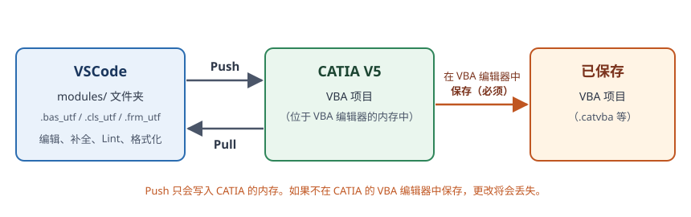
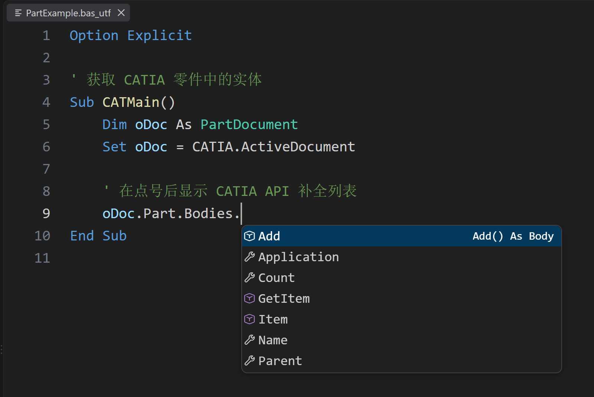
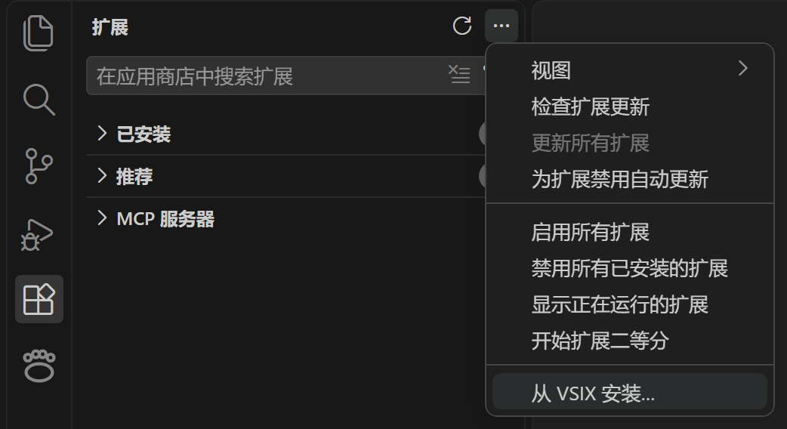
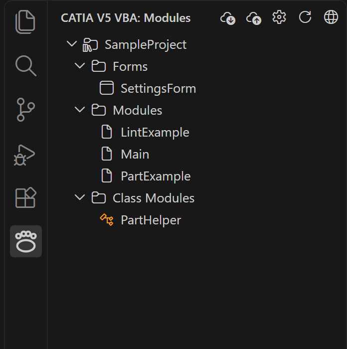

# Cat5Dev

[English](../../README.md) | [日本語](../ja/README.ja.md) | 简体中文

Cat5Dev 是一款用于在 VSCode 中开发 CATIA V5 VBA 宏的扩展。
它在 CATIA 的 VBA 项目与 VSCode 之间传递模块，让您可以在 VSCode 中借助补全、Lint 和格式化来编辑代码。

---

## 主要功能

| 功能 | 概要 | 详细 |
|------|------|------|
| **Pull / Push** | 在 CATIA 的 VBA 项目与 `modules/` 文件夹之间同步模块。仅发送有变更的模块，删除前会进行确认 | [同步](sync.md) |
| **模块树** | 在侧边面板中按类型显示模块。支持重命名、删除、复制路径 | [同步](sync.md#模块树) |
| **IntelliSense** | 包括 CATIA API 在内的代码补全、悬停、转到定义、参数提示、检测不存在的成员 | [IntelliSense](intellisense.md) |
| **符号导航** | 大纲、面包屑导航、通过 `Ctrl+Shift+O` 跳转到过程 | [IntelliSense](intellisense.md#符号导航) |
| **VBA Lint** | 缺少 `Option Explicit`、未使用的变量、遗漏 `End If` 等 9 种规则（默认禁用） | [Lint 与格式化程序](lint-format.md#vba-lint) |
| **VBA 格式化程序** | 关键字大写、缩进、整理空白与空行（默认禁用） | [Lint 与格式化程序](lint-format.md#vba-格式化程序) |
| **多语言显示** | 日本語、English、简体中文 | [配置](configuration.md#显示语言) |

---

## 运行环境

- Windows（64 位）
- CATIA V5 已启动，并已打开要同步的 VBA 项目
- **执行 Pull / Push 前，已至少打开过一次 CATIA 的 VBA 编辑器（`Alt+F11`）**（之后关闭也可以）
- VSCode 1.85 或更高版本

本扩展通过随附的辅助程序 `catia-run.exe` 以 COM 方式与 CATIA 通信。该程序运行于 Windows 10/11 自带的 .NET Framework 4.x。

选择项目或执行 Pull / Push 时，会在 CATIA 中临时加载中介 VBA 项目 `C5D_Bridge`，操作结束后将其移除。操作进行中的短暂时间内，VBA 编辑器中可能会显示 `C5D_Bridge`，但它不会被保存。本扩展不使用 VBScript（[工作原理](sync.md#与-catia-通信的机制)）。
`C5D_Bridge` 的文件存放在 `%LOCALAPPDATA%\Cat5Dev\bridge\` 中，每次处理时会在其中创建指向它的链接（几乎不占用磁盘空间）。CATIA 运行期间这些链接被占用而会保留，但会在 CATIA 退出后的下一次处理时自动删除（[`bridge` 文件夹中的文件](sync.md#bridge-文件夹中的文件)）。

---

## 安装

Cat5Dev 以 `.vsix` 文件形式分发。

1. **下载 `.vsix` 文件**\
   从[发布页面](https://github.com/kantoku-code/Cat5Dev/releases)获取 `cat5dev-x.x.x.vsix`。

2. **在 VSCode 中安装**\
   打开扩展视图（`Ctrl+Shift+X`），从右上角的 `⋯` 菜单中选择 **从 VSIX 安装...**。

   

3. **选择文件**\
   选择下载的 `.vsix` 文件进行安装。

> [!WARNING]
> **首次使用前，请备份 CATIA V5 的设置文件夹。**\
> 在极少数情况下，CATIA 的设置可能会损坏。有备份就可以恢复。
>
> 1. 按 `Win+R` 并输入 `%APPDATA%`
> 2. 打开 `Dassault Systemes\CATSettings` 文件夹
> 3. 复制该文件夹，并粘贴到安全的位置（桌面、OneDrive 等）
> 4. 重命名备份（例如：`CATSettings_backup_2026-04-18`）

---

## 快速入门

1. 在 VSCode 中打开工作文件夹。
2. 在命令面板（`Ctrl+Shift+P`）中运行 **`CATIA: Initialize Project (cat5dev.toml)`**。\
   这会创建配置文件 `cat5dev.toml` 和 `.gitignore`。
3. 启动 CATIA V5，并打开要同步的 VBA 项目。\
   **同时请打开一次 VBA 编辑器（`Alt+F11`）。** 从未打开过 VBA 编辑器时无法执行 Pull / Push（之后关闭也可以）。
4. 单击活动栏中的 **CATIA V5 VBA** 图标打开面板。
5. 单击 ⚙️ 按钮，选择目标 VBA 项目。
6. 单击 ☁️↓ 按钮（Pull），模块会被导入到 `modules/` 文件夹。
7. 在 VSCode 中编辑代码。
8. 单击 ☁️↑ 按钮（Push），更改会被发送到 CATIA。
9. **在 CATIA 的 VBA 编辑器中保存项目**（请参阅下面的注意事项）。

> [!TIP]
> Lint 和格式化程序默认处于禁用状态。如需使用，请在 `cat5dev.toml` 的 `[lint]` 和 `[formatter]` 中设置 `enabled = true`（参见 [Lint 与格式化程序](lint-format.md)）。

---

## 重要：Push 之后请在 CATIA 的 VBA 编辑器中保存

Push 只会写入 CATIA 内存中的 VBA 项目。**如果不保存就关闭 CATIA，所有 Push 的更改都会丢失。**\
从 VSCode 执行 Push 后，请在 CATIA 的 VBA 编辑器中保存（`Ctrl+S`）。

此外，Push 时可能会询问 **是否从 CATIA 中删除 VSCode 端不存在的模块**。请仔细确认内容后再做选择（参见 [同步](sync.md#pushvscode--catia)）。

---

## 文档

| 页面 | 内容 |
|------|------|
| [与 CATIA 同步](sync.md) | Pull / Push 的行为与确认对话框、模块树、与 CATIA 通信的机制（中介项目 C5D_Bridge 与 `bridge` 文件夹）、同步锁及其恢复、字符编码 |
| [IntelliSense](intellisense.md) | 补全、悬停、转到定义、参数提示，类型提示 `'@As`，CATIA API 的类型信息 |
| [Lint 与格式化程序](lint-format.md) | Lint 规则列表、格式化程序的处理内容与选项 |
| [配置参考](configuration.md) | `cat5dev.toml` 的全部选项、显示语言、VSCode 设置、生成的文件 |
| [故障排除](troubleshooting.md) | 常见问题及解决方法、如何查看输出面板 |

---

## 限制事项

- 无法在 VSCode 中进行调试运行。调试请使用 CATIA 的 VBA 编辑器。
- 用户窗体只处理代码。窗体的设计（控件的布局）请在 CATIA 的 VBA 编辑器中编辑。
- 无法通过 Push 新建用户窗体。请先在 CATIA 端创建同名的空窗体。

---

## 为什么选择 VBA？

我曾尝试用多种语言进行 CATIA V5 宏开发，但出于以下几个原因，最终还是回到了 VBA：

- **原生支持** — VBA 直接内置于 CATIA V5 中
- **最佳的开发环境** — VBE 依然是功能最完整、最稳定的选择
- **出乎意料地快** — 在许多情况下，VBA 的表现优于其他方案
- **紧凑的发布** — 不需要外部运行时或依赖项

我喜欢 VBA 这门语言吗？\
那就是另一个话题了。

---

## 许可证

MIT
