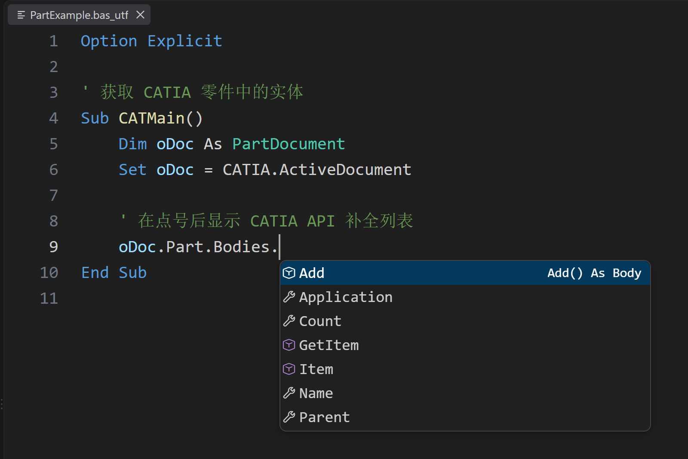
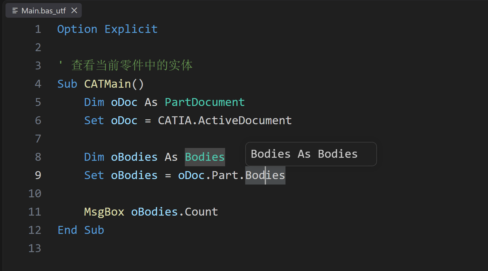

# IntelliSense（补全、悬停、转到定义）

[← 返回 README](README.zh-CN.md)

Cat5Dev 内置了 VBA 语言服务器（`vba-ls`），在编辑 `.bas_utf` / `.cls_utf` / `.frm_utf` 文件时可以使用以下功能。无需任何配置。

| 功能 | 使用方法 |
|------|----------|
| [代码补全](#代码补全) | 输入时自动显示，或按 `Ctrl+Space` |
| [悬停](#悬停) | 将鼠标悬停在标识符上 |
| [转到定义](#转到定义) | `F12` 或 `Ctrl+单击` |
| [参数提示](#参数提示) | 输入 `(`、`,` 或空格时自动显示 |
| [类型着色](#类型着色) | 自动 |
| [检测不存在的成员](#检测不存在的成员) | 自动（波浪线和“问题”面板） |
| [符号导航](#符号导航) | 大纲、面包屑导航、`Ctrl+Shift+O` |

由于内置了 CATIA V5 对象（`Part`、`PartDocument`、`HybridShapeFactory` 等）的类型信息，CATIA 的方法和属性也可以补全。

---

## 代码补全



| 输入位置 | 显示的候选项 | 示例 |
|----------|--------------|------|
| `.` 之后 | 该类型的方法和属性 | `CATIA.ActiveDocument.` → `Document` 的成员 |
| `As ` / `New ` / `Implements ` 之后 | 类型名称 | `Dim oPart As ` → `Part`, `Body`, … |
| `Exit ` / `End ` / `On Error ` / `Option ` 等之后 | 后续关键字 | `End ` → `If`, `Sub`, `With`, … |
| 其他位置 | 变量、过程、常量、关键字 | `oP` → `oPart`, … |

- **`.` 补全**也适用于 `With` 块内的 `.Foo`、`Me.`、数组或 `Item` 的结果、函数的返回值以及模块名（`Module1.`）。
- **类型补全**按以下顺序排列：自定义的类、用户定义类型和枚举，VBA 的类型，CATIA 的类型。`New ` 之后只显示可以创建的类型（类、`Collection`、`Dictionary` 等）。也可以像 `As MECMOD.` 这样用库名进行筛选。
- **标识符补全**按以下顺序排列：局部变量 → 模块内的变量和过程 → 其他模块的 Public 成员 → VBA 的函数和常量、CATIA 的枚举值 → 关键字。
- 在字符串和注释中不进行补全。

---

## 悬停



将鼠标悬停在标识符上，会显示其声明和说明。

- **变量和过程** — 声明形式（例如：`Dim oPart As Part`、`Function GetName(ByVal n As Long) As String`）和文档注释
- **成员** — `x.Foo` 中 `Foo` 的签名（例如：`Add(Name As String) As Body`）
- **CATIA 的类型** — 类型名称、所属库、继承关系（例如：`PartDocument ← Document ← …`）
- **VBA 的函数和常量** — 签名和说明

### 文档注释
写在声明**前一行**的注释，会作为悬停和补全中的说明显示。变量也可以使用行尾注释。

```vba
' 返回零件的名称
' n: 零件的编号
Function GetName(ByVal n As Long) As String
    Dim oPart As Part   ' 正在处理的零件
    ...
End Function
```

如果中间隔有空行或代码，则不会被视为说明。

---

## 转到定义

按 `F12`（或 `Ctrl+单击`）可跳转到变量、过程、类或模块的定义位置。也可以跳转到写在其他模块中的定义。

- 对于模块名或类名，会跳转到该文件的开头。
- CATIA 或 VBA 内置的内容没有定义位置，因此不会跳转。

---

## 参数提示

输入函数的 `(` 或 `,` 时，会显示参数列表，并突出显示当前正在输入的参数。

- 也支持不使用括号的调用（`MsgBox "x", `、`Err.Raise ` 等）。
- 也支持命名参数（`Title:=`）。
- 如果参数类型是 CATIA 的枚举类型，最多显示 10 个可用的值。

---

## 类型着色

类型为对象（CATIA 的类型、`Collection`、自定义类等）的变量，以及 `As` 之后的类型名称，会以不同于普通变量的颜色显示。`Long`、`String` 等基本类型的变量不在此列。

---

## 检测不存在的成员

在 `.` 之后写了该类型中不存在的方法或属性时，会用波浪线提示。“问题”面板中显示的来源为 `vba-ls`。

这些消息与显示语言无关，始终以日语显示。

| 目标类型 | 严重程度 | 消息示例（日语） |
|----------|----------|------------------|
| VBA 的类型、自定义类和模块 | 错误 | `'clsFoo' に 'Bar' は存在しません`（“'clsFoo' 中不存在 'Bar'”） |
| CATIA 的类型 | 警告 | `'PartDocument' に 'Bogus' は存在しません（派生型を含む）`（“'PartDocument' 中不存在 'Bogus'（包括派生类型）”） |

- 对于 CATIA 的类型，如果成员存在于所声明类型的**派生类型**中，则不会发出警告（例如：`Dim d As Document` 时 `d.Part` 没有问题）。
- 有语法错误的模块和用户窗体（因为没有控件信息）不会被检查。
- 此检测与 `cat5dev.toml` 的 `[lint]` 设置无关，也没有禁用它的设置。

---

## 类型提示 `'@As`

用 `As Object` 或 `As Variant` 声明的变量类型未知，因此不会显示补全。例如，即使赋值 `Set oDoc = CATIA.ActiveDocument`，也不会推断其类型。

对于这样的变量，可以在声明的**行尾注释**中指定类型。

```vba
Sub Main()
    Dim oDoc As Object '@As PartDocument
    Set oDoc = CATIA.ActiveDocument
    oDoc.Part.Bodies.          ' ← 会补全 Bodies 的成员

    Dim sel '@As Selection                 ' 也可用于未写类型的变量
    Dim oBody As Object 'As MECMOD.Body    ' 可以省略 @，也可以带库名
End Sub
```

- 格式为 `'@As 类型名` 或 `'As 类型名`（不区分大小写）。整条注释必须是这种形式（像 `'As Part 的说明` 这样后面还有文字时会被忽略）。
- 可用于 `Dim` / `Static` / 模块级别的 `Public` / `Private`。为 Public 变量添加的类型提示，在其他模块中使用时也有效。
- 仅在一行声明一个变量时有效（`Dim a As Object, b As Object '@As Part` 会被忽略）。
- 不能用于 `As Long` 等明确指定了类型的变量，也不能用于过程的参数。
- 实际的声明不会改变。仅用于补全、悬停、参数提示、检测和转到定义。
- 如果找不到类型名称，则会被忽略。

> [!TIP]
> 对于像 `Set x = New Foo` 或 `Set x = CreateObject("Scripting.Dictionary")` 这样赋值的、未写类型的变量，即使没有类型提示也会推断出类型。

---

## CATIA API 类型信息

CATIA V5 的类型信息从随附的数据库 `bin/catia_api.db` 中读取（根据 CATIA V5 的 102 个类型库生成，**不包含**方法和属性的说明文字）。

### 如需显示说明文字
可以根据您的 CATIA 附带的帮助文件（`V5Automation.chm`）生成包含说明文字的数据库。

1. 按照 [tools/tlb-extractor/README.md](../../tools/tlb-extractor/README.md) 中的步骤生成数据库
2. 将环境变量 `CAT5DEV_TLB_DB` 设置为所生成数据库的完整路径
3. 重启 VSCode

> [!NOTE]
> 说明文字是 Dassault Systèmes 的著作物。请不要共享生成的数据库，也不要将其提交到代码仓库中。

---

## 跨模块功能

读取工作区 `modules/` 文件夹下一级的文件，可以在模块之间使用补全、悬停和转到定义（没有 `modules/` 时则读取工作区根目录下一级的文件）。

- **标准模块** — Public 的过程和变量既可以直接使用（`Foo`），也可以带模块名使用（`Module1.Foo`）。
- **类模块** — 写成 `Dim c As clsFoo` 后，输入 `c.` 会补全 Public 成员。
- **用户窗体** — 可以像 `frmMenu.` 这样通过窗体名使用。但无法补全窗体上的控件。
- 文件的添加、删除和重命名（包括 Pull 带来的变更）会自动反映。

---

## 符号导航

- **大纲** — 在资源管理器下方的“大纲”中，列出文件中的 `Sub` / `Function` / `Property Get/Let/Set` / `Type` / `Enum`。
- **面包屑导航** — 在编辑器上方显示光标所在位置的过程名。
- **转到符号**（`Ctrl+Shift+O`） — 选择过程名并跳转。

面包屑导航的排序方式可以在 `cat5dev.toml` 中更改。

```toml
[editor]
breadcrumbs_sort = "name"   # position = 代码顺序 / name = 按名称 / type = 按类型
```

该值会写入工作区设置（`.vscode/settings.json`）的 `breadcrumbs.symbolSortOrder`，并应用于此工作区中的所有文件。没有该键时不会更改工作区设置。

---

## 限制事项

- **类型推断有限。** 通过 `Set x = 表达式` 确定类型的只有 `New X` 和 `CreateObject("…")`。其他情况请声明类型，或使用 [类型提示](#类型提示-as)。
- **CATIA 的属性返回基础类型。** `CATIA.ActiveDocument.` 显示的是 `Document` 的成员，而不是 `PartDocument` 的成员。请声明为 `Dim oDoc As PartDocument`。
- **窗体的控件**不在补全和检测的范围内。
- **只读取 `modules/` 下一级的文件。** 不包括子文件夹，上限为 2,000 个文件。
- 如果存在多个**同名模块**，只会使用其中一个。
- 输入过程中存在语法错误时，该模块的部分补全可能会暂时不显示。
- 不支持查找引用、批量重命名和代码操作。

如果无法正常工作，请参阅 [故障排除](troubleshooting.md#补全或悬停不显示)。
