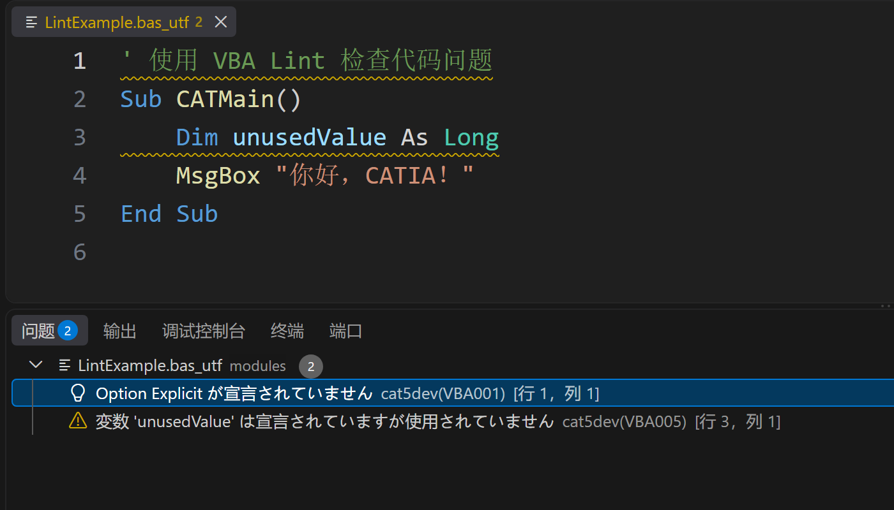

# Lint 与格式化程序

[← 返回 README](README.zh-CN.md)

两者**默认均为禁用**。请在工作区根目录的 `cat5dev.toml` 中启用（如果没有 `cat5dev.toml`，请参阅 [配置](configuration.md) 创建）。

对 `cat5dev.toml` 的更改在保存后立即生效（无需重新加载 VSCode）。

---

## VBA Lint

在打开文件时、编辑时（停止输入 0.5 秒后）和保存时检查代码，并通过编辑器中的波浪线和“问题”面板显示问题。“问题”面板中显示的来源为 `cat5dev`。



截图中的部分 Lint 诊断信息由扩展提供，目前仍以日语显示。

### 启用
```toml
[lint]
enabled = true
```

> [!NOTE]
> 通过 `CATIA: Initialize Project (cat5dev.toml)` 创建的 `cat5dev.toml` 中为 `enabled = false`。要使用 Lint，请将其改为 `true`。

### 规则列表
| 代码 | 内容 | 严重程度 | `[lint.rules]` 的键 | 默认值 |
|------|------|----------|---------------------|--------|
| VBA001 | 未声明 `Option Explicit` | 警告 | `option_explicit` | `true` |
| VBA002 | 使用了 `On Error Resume Next` | 警告 | `on_error_resume_next` | `false` |
| VBA003 | 使用了 `GoTo`（`On Error GoTo` 除外） | 警告 | `goto` | `false` |
| VBA004 | 行过长 | 警告 | `max_line_length` | `100`（字符。`0` 为禁用） |
| VBA005 | 使用 `Dim` 声明的变量未被使用 | 警告 | `unused_variables` | `true` |
| VBA006 | 嵌套过深 | 警告 | `max_nesting_depth` | `5`（`0` 为禁用） |
| VBA007 | `Sub` / `Function` 的行数过多 | 警告 | `max_function_lines` | `300`（行。`0` 为禁用） |
| VBA008 | 括号不匹配 | 错误 | `unmatched_parens` | `true` |
| VBA009 | 缺少 `End If` / `End Sub` / `End Function` 等 | 错误 | `unmatched_blocks` | `true` |
| VBA010 | 存在 CATIA 的 VBA 无法表示的字符（表情符号等）（[见下文](#vba010-catia-的-vba-无法表示的字符)） | 警告 | `non_ansi_character` | `true` |

`true` / `false` 类规则设为 `false` 即禁用，数值类规则设为 `0` 即禁用。

```toml
[lint.rules]
option_explicit      = true
on_error_resume_next = false
goto                 = false
max_line_length      = 100
unused_variables     = true
max_nesting_depth    = 5
max_function_lines   = 300
unmatched_parens     = true
unmatched_blocks     = true
non_ansi_character   = true
ansi_code_page       = 0     # VBA010 判断所用的代码页（0 = 自动检测）
```

### VBA010: CATIA 的 VBA 无法表示的字符
CATIA 的 VBA 以 Windows 系统的 ANSI 代码页保存模块正文（简体中文版 Windows 为代码页 936 = GBK，日语版为 932 = Shift-JIS 等）。该代码页无法表示的字符在 Push 时会**在没有任何提示的情况下被替换为 `?` 等其他字符**（参见 [字符编码](sync.md#字符编码)）。VBA010 会在 Push 之前对这类字符发出警告。

```vba
MsgBox "完成🙂"   ' 对 🙂 发出警告：Push 后会变成 ?
```

- 无论字符出现在标识符、字符串还是注释中，都会检查。
- 逐个字符检查“转换为代码页后再转换回来是否与原字符相同”。连续的字符合并为一条警告，波浪线只标在这些字符上。
- 消息示例：`CATIA 的 VBA（代码页 936）无法表示此字符，Push 后会被替换为 ? 等其他字符: 🙂`
- 代码页 936 下，表情符号（`🙂` 等）、韩文、半角片假名（`ｱ`）等会发出警告，汉字、`①` 等不会。代码页 932 下，半角片假名不会发出警告，但 `〜`（U+301C，Push 后变为 `～`）、`−`（U+2212）、`¥`（变为 `\`）等会发出警告。

#### 判断所用的代码页
通过 `[lint.rules]` 的 `ansi_code_page` 指定。

| 值 | 行为 |
|----|------|
| `0`（默认） | 使用本机系统的 ANSI 代码页。扩展启动时仅读取一次注册表 `HKLM\SYSTEM\CurrentControlSet\Control\Nls\CodePage` 中的 `ACP`。读取失败时，根据 VSCode 的显示语言推定（中文（简体）→ 936、中文（繁体）→ 950、韩语 → 949、其他 → 932） |
| `936`、`932` 等 | 使用指定的代码页。运行 CATIA 的电脑与编辑此工作区的电脑系统代码页不同时请指定。也可以写成 `"cp936"` 或 `"auto"`（= `0`） |

- 所用的代码页会在输出面板“CATIA VBA Sync”中记录一行，例如 `[vba-lint] 系统的 ANSI 代码页: 936 …`。
- 支持的代码页为 874、932、936、949、950、1250～1258。其他代码页（例如启用 Windows 的“Beta 版: 使用 Unicode UTF-8 提供全球语言支持”时的 65001）会禁用 VBA010，并在输出面板中记录。
- 更改 Windows 的系统区域设置后，请重新启动 VSCode 以重新检测。

> [!IMPORTANT]
> `ansi_code_page` **仅用于 Lint 的 VBA010 判断**。它与 0.7.0 中废弃的 `[project]` 的 `encoding`（与 CATIA 交换数据时使用的字符编码）无关，不会影响 Push / Pull 的行为。

### 注意事项
- 无论显示语言如何设置，VBA001～VBA009 的消息始终以日语显示。VBA010 的消息会按照显示语言（日语、英语、中文）显示。
- VBA005 只检查 `Dim` 中的第一个变量（`Dim a, b` 中只检查 `a`）。检查对象是过程内的 `Dim`，不包括 `Private` / `Public` / `Static` 声明。
- VBA006 将过程本身计为 1 层。`Select Case` 计为 2 层。
- 检测不存在的成员（来源 `vba-ls`）是与 Lint 不同的功能。请参阅 [IntelliSense](intellisense.md#检测不存在的成员)。

---

## VBA 格式化程序

整理代码的格式。在 VSCode 的“格式化文档”（`Shift+Alt+F`）时运行。通过设置，也可以在保存文件时和 Pull 时格式化。

### 启用
```toml
[formatter]
enabled = true
```

### 默认执行的处理
| 处理 | 示例 | 键 |
|------|------|-----|
| 关键字大写 | `dim` → `Dim`、`end if` → `End If` | `capitalize_keywords` |
| 修正缩进 | `Sub` / `If` / `For` / `Do` / `With` / `Select Case` 等代码块 | `fix_indentation` |
| 删除行尾空白 | | `trim_trailing_space` |
| 在续行符 `_` 前添加空格 | `Show(_` → `Show( _` | `ensure_continuation_space` |
| 续行缩进 | 以 `_` 结尾的行的下一行缩进一级 | `indent_continuation_lines` |
| 整理空行 | 连续空行最多保留 2 行 | `max_blank_lines` |

- 缩进单位为 `indent_size`（默认 4 个空格）。
- `Select Case` 内部，`Case` 缩进 1 级，其内容缩进 2 级。写在一行中的 `If … Then …` 不视为代码块。
- 续行缩进仅在 `fix_indentation = true` 时生效。只有 `)` 或 `]` 的行不会缩进。
- 整理空行时，如果 `End Sub` 等之后紧接着下一个过程，会插入 1 个空行。设置 `max_blank_lines = 0` 后，将完全不整理空行。
- 不会修改字符串和注释中的内容。
- 格式化后的文件换行符为 CRLF，并且末尾带 1 个换行。

### 选项（默认禁用）
| 键 | 示例 |
|-----|------|
| `normalize_operator_spacing` | `x=1+2` → `x = 1 + 2` |
| `normalize_comma_spacing` | `foo(a,b)` → `foo(a, b)` |
| `normalize_comment_space` | `'comment` → `' comment` |
| `expand_type_suffixes` | `Dim x%` → `Dim x As Integer` |

### 全部选项与默认值
```toml
[formatter]
enabled = false                    # true 为启用
indent_size = 4
capitalize_keywords = true
fix_indentation = true
trim_trailing_space = true
ensure_continuation_space = true
indent_continuation_lines = true
max_blank_lines = 2                # 0 = 禁用
normalize_operator_spacing = false
normalize_comma_spacing = false
normalize_comment_space = false
expand_type_suffixes = false
format_on_save = false             # 保存时格式化
format_on_pull = false             # 格式化通过 Pull 导入的文件
```

### 格式化的时机
| 时机 | 条件 |
|------|------|
| `Shift+Alt+F`（格式化文档） | `enabled = true` |
| 保存文件时 | `enabled = true` 且 `format_on_save = true` |
| Pull 时 | `enabled = true` 且 `format_on_pull = true` |

- 不支持只格式化选定范围（“格式化选定内容”）。始终格式化整个文件。
- 如果启用了 VSCode 的 `editor.formatOnSave`，则无论 `format_on_save` 如何，保存时都会格式化（`enabled = true` 时）。
- 格式化程序的所有设置都写在 `cat5dev.toml` 的 `[formatter]` 中。VSCode 设置界面中没有格式化程序的设置项。

### 在命令行中使用
格式化程序本体 `vbafmt.exe`（位于扩展文件夹的 `bin/` 中）也可以作为独立命令使用。它接收一个文件（或标准输入），并将格式化结果输出到标准输出。它不读取 `cat5dev.toml`，选项通过参数指定（列表见 `vbafmt.exe -h`）。

```bat
vbafmt.exe modules\Module1.bas_utf > Module1_formatted.bas_utf
vbafmt.exe --normalize-comma-spacing modules\Module1.bas_utf
vbafmt.exe --check modules\Module1.bas_utf   :: 需要格式化时退出码为 1（适用于 CI）
```
