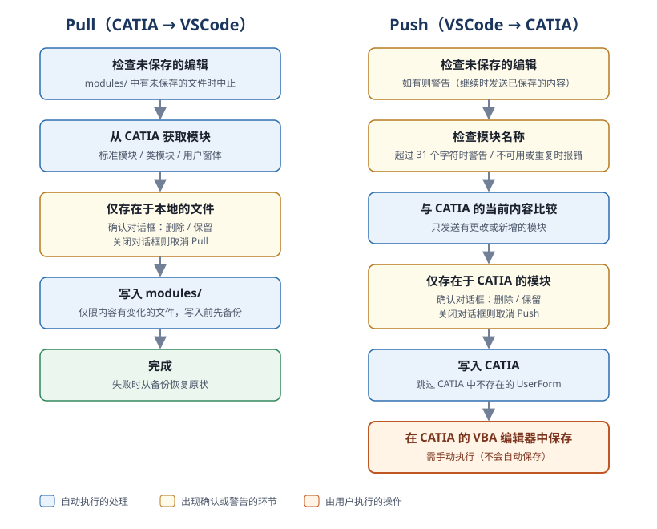
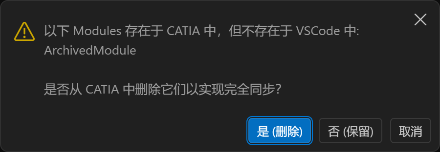
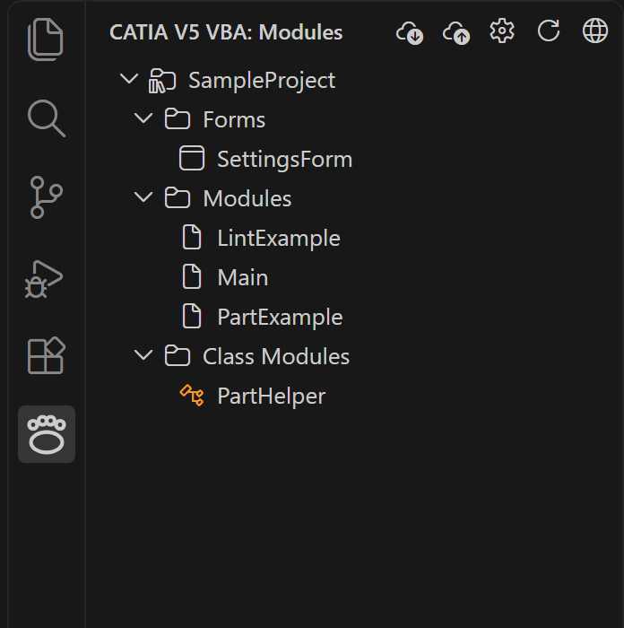

# 与 CATIA 同步（Pull / Push）

[← 返回 README](README.zh-CN.md)

Cat5Dev 在 CATIA V5 的 VBA 项目与工作区的 `modules/` 文件夹之间传递模块。

- [选择目标项目](#选择目标项目)
- [Pull（CATIA → VSCode）](#pullcatia--vscode)
- [Push（VSCode → CATIA）](#pushvscode--catia)
- [模块树](#模块树)
- [与 CATIA 通信的机制](#与-catia-通信的机制)
- [防止并发执行与同步锁](#防止并发执行与同步锁)
- [字符编码](#字符编码)

---

## 选择目标项目

单击面板顶部的 ⚙️ 按钮（`CATIA: Select Target Project`），会列出 CATIA 中已打开的 VBA 项目。所选名称会保存到 `cat5dev.toml` 中 `[project]` 部分的 `target_project`。

> [!IMPORTANT]
> 在没有 `cat5dev.toml` 的情况下，所选的项目名称**不会被保存**（虽然会显示“已将目标 VBA 项目设置为 …”，但树视图仍然为空）。请先在命令面板中运行 `CATIA: Initialize Project (cat5dev.toml)` 创建 `cat5dev.toml`。

- 如果在未设置目标项目的情况下执行 Pull / Push，会先打开此选择界面。
- 项目名称的匹配区分大小写。

---

## Pull（CATIA → VSCode）

通过面板顶部的 ☁️↓ 按钮（`CATIA: Pull VBA Modules`），将目标项目的模块导入到 `modules/` 文件夹。

### 导入的内容
| 类型 | 保存的文件 |
|------|------------|
| 标准模块 | `modules/<名称>.bas_utf` |
| 类模块 | `modules/<名称>.cls_utf` |
| 用户窗体 | `modules/<名称>.frm_utf`（仅代码部分） |

- 文档模块等上述以外的类型不会导入。
- 用户窗体只导入代码。不处理窗体的设计（控件的布局）和 `.frx` 文件。
- 文件以 UTF-8（无 BOM）、换行符 LF 保存。
- 保存位置固定为 `modules/`（不可更改）。如果文件夹不存在则会创建。

### 处理流程
1. 如果 `modules/` 中有存在**未保存编辑**的文件，则中止（请先保存）。
2. 从 CATIA 获取模块。
3. 如果有仅存在于本地的文件（CATIA 端不存在），会显示确认对话框。
   - **是 (删除)** — 删除这些文件，使其与 CATIA 保持一致。
   - **否 (保留)** — 保留这些文件，只执行更新和添加。
   - 关闭对话框 — 取消整个 Pull。
4. 只写入内容有变化的文件。覆盖时不会确认。
5. 完成后刷新树视图。

### 失败时的安全措施
- 写入之前，会在工作区中创建临时文件夹 `.cat5dev-pull-XXXXXX/`，并备份原文件。
- 如果中途失败，或在 Pull 过程中本地文件被修改，则从备份中恢复原状。
- 正常结束后，临时文件夹会被删除。

> [!WARNING]
> 如果恢复处理也失败，`.cat5dev-pull-XXXXXX/` 文件夹会保留下来，其位置会显示在错误消息中。在从其中的 `backup/` 恢复完文件之前，**请不要删除此文件夹**。

### Pull 时自动格式化
在 `cat5dev.toml` 的 `[formatter]` 中写上 `enabled = true` 和 `format_on_pull = true` 后，导入的文件会先经格式化程序格式化再保存（参见 [Lint 与格式化程序](lint-format.md)）。格式化后的文件换行符为 CRLF。

---

## Push（VSCode → CATIA）

通过面板顶部的 ☁️↑ 按钮（`CATIA: Push VBA Modules`），将 `modules/` 文件夹中的模块写入 CATIA。

### 发送的内容
- `modules/` 下一级的 `.bas_utf` / `.cls_utf` / `.frm_utf` 文件（不包括子文件夹）
- 与 CATIA 的**当前内容**进行比较，只发送有更改或新增的模块。换行符的差异、行尾空白、有无 BOM 不视为差异。
- 如果没有任何更改，则显示“…均未更改。已跳过 Push。”并结束。
- 发送的是**已保存到磁盘的内容**。

### 处理流程与确认对话框
1. **存在未保存的编辑时** — 显示警告。选择“继续”后，将发送已保存的内容。
2. **检查模块名称**
   - 如果有超过 31 个字符的名称会发出警告（VBA 编辑器的上限）。
   - 如果有 VBA 中不可用的名称，或仅大小写不同的重复名称，则报错并中止。
3. **存在仅在 CATIA 中存在的模块时** — 显示确认对话框。

   

   - **是 (删除)** — 也从 CATIA 中删除，使其与 VSCode 端保持一致。
   - **否 (保留)** — 保留 CATIA 端的模块。
   - 关闭对话框 — 取消整个 Push。
4. **新的用户窗体**（CATIA 中没有同名窗体的）无法创建，因此会发出警告并跳过。请先在 CATIA 的 VBA 编辑器中创建同名的空用户窗体，然后再执行 Push。
5. 写入 CATIA。CATIA 中不存在的标准模块和类模块会被新建。

> [!CAUTION]
> **Push 之后，请务必在 CATIA 的 VBA 编辑器中保存项目。**
> Push 只会写入 CATIA 内存中的 VBA 项目。如果不保存就关闭 CATIA，所有 Push 的更改都会丢失。

- 如果只有部分模块失败，会显示成功和失败的数量。已写入 CATIA 的模块不会被还原。详细信息可在输出面板的“CATIA VBA Sync”中查看。

---

## 模块树

单击活动栏中的 Cat5Dev 图标，侧边面板中会显示 `modules/` 文件夹的内容。

- 最上方显示目标项目名称。未设置目标项目时不显示任何内容。
- 其下按以下顺序只显示有文件的类型（显示名称为英文）。
  | 显示名称 | 类型 | 扩展名 |
  |----------|------|--------|
  | Forms | 用户窗体 | `.frm_utf` |
  | Modules | 标准模块 | `.bas_utf` |
  | Class Modules | 类模块 | `.cls_utf` |
- 单击模块即可在编辑器中打开。
- 当 `modules/` 中的文件或 `cat5dev.toml` 发生变化时，树视图会自动刷新。如需手动刷新，请单击 🔄 按钮。

### 工具栏按钮
| 图标 | 命令 | 操作 |
|------|------|------|
| ☁️↓ | CATIA: Pull VBA Modules | 从 CATIA 导入 |
| ☁️↑ | CATIA: Push VBA Modules | 写入 CATIA |
| ⚙️ | CATIA: Select Target Project | 选择目标项目 |
| 🔄 | Refresh Modules | 刷新树视图 |
| 🌐 | CATIA: Switch Language | 切换显示语言 |

### 右键菜单
| 菜单 | 操作 |
|------|------|
| Rename（重命名） | 更改文件名（即模块名）。新名称必须是 VBA 中可用的名称，且不能与其他模块重复。用户窗体会显示警告（见下文） |
| Delete（删除） | 确认后将文件移到回收站 |
| Copy Path（复制路径） | 将文件的完整路径复制到剪贴板 |

- 有未保存编辑的文件，无法重命名或删除。请先保存。
- 重命名用户窗体后，下一次 Push 时无法创建新名称的窗体（见上文第 4 步），并且会显示删除旧名称窗体的确认。如果选择删除，窗体的设计将会丢失。

---

## 与 CATIA 通信的机制

在选择项目、Pull 和 Push 时，随附的辅助程序 `catia-run.exe` 会连接 CATIA，并在 CATIA 中临时加载中介 VBA 项目 **`C5D_Bridge`**。模块的读写通过 `C5D_Bridge` 进行。本扩展不使用 VBScript（`.catvbs` 或 `cscript`）。

- 每次处理结束后，`C5D_Bridge` 都会从 CATIA 中移除（Push 时，在检查差异和写入时分别加载并移除）。
- 因此，**在处理进行中的短暂时间内，VBA 编辑器的项目列表中可能会显示 `C5D_Bridge`**。请不要操作它。
- `C5D_Bridge` 以只读方式加载，**不会被保存**，也不会出现在项目选择列表中。
- 只有 Push 会写入您的 VBA 项目，并且只写入目标项目的模块。
- `C5D_Bridge` 只能看到已加载到 VBA 编辑器中的项目，因此 **执行 Pull / Push 前需要先打开一次 VBA 编辑器（`Alt+F11`）**。
- 由于需要加载和移除，每次处理大约多花 1 秒。

### `bridge` 文件夹中的文件
加载到 CATIA 中的 `C5D_Bridge` 文件存放在 `%LOCALAPPDATA%\Cat5Dev\bridge\` 中。

#### 文件夹中有哪些文件
| 文件 | 内容 |
|------|------|
| `C5D_Bridge-<8 位>.catvba` | 扩展随附的 `C5D_Bridge`（约 155 KB）的只读副本（原始文件）。`<8 位>` 随 `C5D_Bridge` 的版本而变化。版本不变期间会一直使用同一个文件 |
| `C5D_Bridge-<8 位>-<CATIA 的进程 ID>-<日期时间>.catvba` | 每次与 CATIA 通信时创建并加载到 CATIA 中的文件（Push 时，检查差异和写入各一次，共 2 次）。它是指向原始文件的硬链接（无法创建硬链接时为只读副本） |

- 硬链接与原始文件共享内容，因此几乎不会增加磁盘占用。在资源管理器中每个文件都显示为约 155 KB，但实际只占用一个文件的空间。如果是副本，则每个约占用 155 KB。

#### 何时删除
- 处理结束后，`C5D_Bridge` 会从 CATIA 中移除（也会从 VBA 编辑器中消失）。但是，移除后 CATIA 仍会占用该文件直到 CATIA 退出，因此无法立即删除。所以在 CATIA 运行期间，每次处理都会增加文件。
- CATIA 退出后，在下一次开始选择项目、Pull 或 Push 时，本扩展会自动删除已不再被占用的文件。
- 当扩展更新导致 `C5D_Bridge` 的版本变化时，旧版本的原始文件也会在此时被删除。当前版本的原始文件会保留。

#### 可以手动删除吗
- 只要 CATIA 已退出，就可以手动删除（删除整个文件夹也没有问题）。原始文件会在下一次处理时重新创建。
- CATIA 运行期间，正在被占用的文件无法删除。无需强行删除。

---

## 防止并发执行与同步锁

与 CATIA 的通信（选择项目、Pull、Push）在同一 Windows 用户下**同时只能执行一个**。如果在其他 VSCode 窗口或工作区中正在执行，会显示以下消息。

> 另一个CATIA操作正在运行，或无法确认其已结束。请在操作结束后重试。

### 显示“无法确认完成”时
如果 CATIA 的处理未在 60 秒内结束（例如 CATIA 中的 MsgBox 等对话框一直处于打开状态时），或 `catia-run.exe` 未返回结果就结束了，则不会视为成功，并显示以下消息。

> 无法确认CATIA操作已完成。已阻止后续操作。关闭CATIA中的MsgBox等后，可通过再次执行时显示的“解除锁定”恢复。

此时 CATIA 中的处理可能仍在进行，也可能已经完成写入，因此为防止误重复写入，**同步锁**会保持保留状态。保留期间，选择项目、Pull、Push 都不会执行。

- 如果之后 CATIA 的处理结束并返回了结果，锁会自动解除（输出面板的“CATIA VBA Sync”中会记录 `[CATIA] Late terminal result received`）。延迟返回的结果不会作为 Pull 的导入内容或 Push 的结果处理，如有需要，请再次执行 Pull 以确认 CATIA 中的内容。
- 如果能确定在向 CATIA 写入任何内容之前就已失败，例如 CATIA 未启动、从未打开过 VBA 编辑器、无法准备中介项目 `C5D_Bridge` 等（`catia-run.exe` 的退出代码为 2、10、11、13、14），则不会显示此消息，锁也会立即解除。请按照显示的消息重新执行。

#### 解除锁定的步骤
如果锁没有自动解除，请按以下步骤解除。

1. 关闭 CATIA 中打开的 MsgBox 等对话框，并确认上一次的处理已经结束
2. 在保留锁的 VSCode 窗口中，再次执行选择项目、Pull 或 Push 中的任意一项
3. 显示以下警告后，点击“解除锁定”

   > 无法确认上一次CATIA操作已完成，同步锁处于保留状态。请关闭CATIA中的MsgBox等，然后点击“解除锁定”。

4. 会打开确认对话框，确认内容后点击“解除锁定”（点击“取消”则锁仍保持保留状态）

   > 请确认CATIA中的对话框已关闭，且上一次操作已结束。
   >
   > 解除锁定后，如果上一次操作稍后在CATIA中执行，可能会重复应用。是否解除锁定？

5. 显示“同步锁已恢复。”后，再次执行原来的操作（仅解除锁定不会执行原来的操作）

- 也可以不再次执行操作，而是在命令面板中运行 `CATIA: Recover Synchronization Lock / 同期ロックを復旧`，通过同样的确认对话框解除锁定。
- **CATIA 可能仍在处理时，请不要解除锁定。** 解除时不会检查 CATIA 是否仍在运行处理。如果在 MsgBox 仍然打开或宏仍在运行时解除锁定并重新执行，上一次的处理可能会稍后在 CATIA 中执行，导致相同的内容被写入两次。
- 解除锁定后，即使上一次操作的结果延迟返回，也会被忽略，不会影响新开始的操作的锁。
- 已解除的操作的临时文件夹（`%TEMP%\cat5dev-…`）会保留下来，以便调查。

#### 未显示“解除锁定”时
只有在以下任一情况下才会显示“解除锁定”按钮。

- 在该窗口中执行的操作以“无法确认完成”结束，且该窗口保留着锁时
- 保留锁的 VSCode 窗口已经关闭或已重新加载时

如果在本窗口或其他窗口中有操作正在执行，或保留锁的窗口仍处于打开状态，则会显示没有按钮的警告（“另一个CATIA操作正在运行，…”）。如果有操作正在执行，请等待其结束后重新执行。如果是其他窗口保留着锁，请在该窗口中执行上述步骤，或关闭该窗口（或通过 `开发人员: 重新加载窗口`（`Developer: Reload Window`）重新加载），之后其他窗口中也会显示“解除锁定”。

如果恢复命令显示以下消息，请按照消息操作：在 CATIA 中保存必要的工作并退出 CATIA，通过 `开发人员: 重新加载窗口`（`Developer: Reload Window`）重新加载保留锁的 VSCode 窗口，然后再次运行 `CATIA: Recover Synchronization Lock / 同期ロックを復旧`。

> 无法安全释放同步锁。如果操作无法结束，请关闭CATIA，重新加载VSCode窗口，然后再次运行恢复命令。

- 锁的信息保存在 `%LOCALAPPDATA%\Cat5Dev\operation-lock\` 中。

---

## 字符编码

VSCode 端的文件为 UTF-8。Pull / Push 时，模块正文以 Unicode 形式与 CATIA 交换（不使用临时文件，也不转换为 Shift-JIS、GBK 等字符编码）。因此，Windows 系统 ANSI 代码页（例如简体中文版 Windows 为 GBK，日文版 Windows 为 Shift-JIS）能够表示的字符（如中文、日文）一定能原样往返。

但是，ANSI 代码页无法表示的字符（例如表情符号 `🙂`）会在 VBA 将其保存到模块时被替换为 `?`。这是 VBA 的规格，与在 VBA 编辑器中直接输入时相同。Push 此类字符后再 Pull，该字符会变为 `?`。

- `cat5dev.toml` 中 `[project]` 部分的 `encoding` 已不再使用。旧的 `cat5dev.toml` 中即使保留该项也会被忽略（不会报错），也可以将其删除。
- 发送到 CATIA 之后，VBA 编辑器中的显示以及保存项目时的处理方式取决于 CATIA（VBA）。
